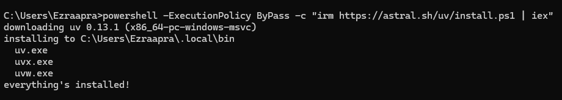

# Praktik 02 - Komunikasi Antar Proses pada Sistem Terdistribusi

---

Judul : Komunikasi pada Sistem Terdistribusi  
Mata Kuliah : __Praktikum Sistem Terdistribusi dan Terdesentralisasi__

| Field | Keterangan |
| :--- | :--- |
| **Nama** | Ezra Adyatma Pranantio |
| **NIM** | 255410002 |

---

## 📌 Tujuan Praktikum
1.Mempelajari dan memahami konsep dasar pengelolaan serta komunikasi antar proses yang terjadi pada satu node (komputer tunggal) yang dikendalikan oleh sistem operasi.

2.Mengetahui cara memantau, mengelola, me-restart, hingga mematikan proses sistem atau aplikasi yang sedang berjalan menggunakan Task Manager pada Windows maupun perintah terminal pada Linux.

3.Memahami tantangan komunikasi antar proses pada sistem terdistribusi yang melibatkan banyak node tanpa adanya shared memory dan perbedaan clock

4.Mempelajari cara menggunakan peranti pengembangan seperti uv untuk membangun workspace dan mengelola lingkungan virtual Python.

5.Mengimplementasikan dan menjalankan server GraphQL menggunakan bahasa pemrograman Python (paket Strawberry) untuk melayani permintaan query dari client secara terdistribusi.

## 📖 Dasar Teori

Proses merupakan hasil dari eksekusi program atau aplikasi yang bersifat _executable_, di mana setiap proses dikelola secara langsung oleh sistem operasi dan terdiri atas _executable_ code, data, resources, serta informasi mengenai state (seperti stack dan heap). Pada sebuah sistem dengan satu node, seluruh eksekusi, alokasi sumber daya, pengelolaan, hingga komunikasi antar proses dikendalikan sepenuhnya oleh sistem operasi secara transparan bagi pengguna. Seluruh proses tersebut berjalan pada clock yang sama serta memungkinkan penggunaan shared memory, sehingga penyelarasan dan pengurutan proses dapat dikendalikan dengan baik.

Sebaliknya, pengelolaan proses pada sistem terdistribusi yang melibatkan lebih dari satu node memiliki kompleksitas yang berbeda karena antar node tidak berada pada clock yang sama dan tidak memungkinkan penggunaan shared memory demi alasan keamanan. Oleh karena itu, dibutuhkan mekanisme komunikasi antar proses secara khusus yang menjembatani client (peminta layanan) dan server (pemberi layanan) di node yang terpisah. Salah satu teknologi yang dapat digunakan adalah **GraphQL**, di mana sebuah server dapat dibuat untuk melayani berbagai query dari client menggunakan spesifikasi terstandarisasi, salah satunya memanfaatkan bahasa pemrograman Python melalui pustaka **Strawberry**.

---

# 📝Pembahasan Praktikum

## Tugas Bagian 1 - Pengelolaan Proses pada Satu Node

### 1.Menampilkan Daftar Proses Sistem

#### Pembahasan :
Membuka alat pemantau sistem seperti Task Manager pada Windows, untuk melihat seluruh proses aplikasi dan latar belakang yang sedang berjalan pada komputer.

### 2.Menjalankan Aplikasi dan Memantau Prosesnya

#### Pembahasan :
Membuka salah satu aplikasi (misalnya Chrome), lalu mengidentifikasi kemunculan proses baru beserta alokasi sumber daya CPU dan memorinya di dalam Task Manager atau terminal.

### 3.Merestart Menjalankan Aplikasi dan Memantau Prosesnya

#### Pembahasan :
Pada praktikum ini, dilakukan pengamatan terhadap proses yang berjalan pada sistem operasi Windows menggunakan Task Manager. Praktikum bertujuan untuk memahami bagaimana sistem operasi mengelola proses dari aplikasi yang sedang dijalankan. Task Manager menampilkan berbagai proses, seperti Browser, GPU Process, Crashpad, Utility: Network Service, dan Tab: New tab. Proses-proses tersebut menunjukkan bahwa satu aplikasi, seperti Microsoft Edge, dapat menjalankan beberapa proses untuk menangani fungsi yang berbeda. Melalui pengamatan ini, dapat diketahui bahwa sistem operasi mengatur proses dan penggunaan sumber daya komputer, seperti CPU, memori, dan jaringan.

Selanjutnya, dilakukan pengamatan terhadap proses aplikasi melalui menu klik kanan pada Task Manager. Pada gambar pertama, tersedia opsi End task untuk menghentikan proses yang dipilih, serta Go to details untuk melihat informasi proses secara lebih terperinci. Opsi tersebut membantu pengguna mengidentifikasi dan mengelola proses yang sedang berjalan. Dengan demikian, Task Manager dapat digunakan untuk memantau aktivitas aplikasi dan melakukan tindakan terhadap proses tertentu sesuai kebutuhan.

Praktikum juga memperlihatkan cara menjalankan kembali Microsoft Edge melalui Command Prompt menggunakan perintah start "" msedge. Pada perintah tersebut, start digunakan untuk menjalankan aplikasi, tanda kutip kosong "" berfungsi sebagai judul jendela, sedangkan msedge merupakan perintah untuk membuka Microsoft Edge. Perintah ini dapat digunakan untuk menjalankan kembali aplikasi setelah proses sebelumnya dihentikan. Namun, perintah tersebut menjalankan aplikasi kembali dan tidak secara langsung melakukan restart terhadap proses yang sama. Melalui kegiatan ini, praktikan memahami perbedaan antara menghentikan proses melalui Task Manager dan menjalankan aplikasi kembali menggunakan Command Prompt.

## Tugas Bagian 2 - Pengelolaan Proses pada Satu Node

### 1. Instalasi uv sebagai Pengelola Environment Python pada Windows

#### Pembahasan :
Pada praktikum ini, dilakukan instalasi uv pada sistem operasi Windows menggunakan Command Prompt. uv merupakan alat yang digunakan untuk mengelola lingkungan Python serta membantu proses instalasi paket yang dibutuhkan dalam pengembangan program. Instalasi dilakukan dengan menjalankan perintah powershell -ExecutionPolicy ByPass -c "irm https://astral.sh/uv/install.ps1 | iex". Perintah tersebut menjalankan PowerShell dengan kebijakan eksekusi yang mengizinkan skrip instalasi berjalan, mengambil skrip instalasi dari situs resmi uv, kemudian mengeksekusinya.

Berdasarkan hasil pada gambar, proses instalasi berhasil mengunduh uv versi 0.13.1 untuk arsitektur Windows 64-bit dan memasang berkasnya pada direktori C:\Users\Ezraapra\.local\bin. Proses tersebut juga menghasilkan beberapa program pendukung, yaitu uv.exe, uvx.exe, dan uvw.exe. Pesan everything's installed! menunjukkan bahwa proses instalasi telah selesai tanpa menampilkan kesalahan pada hasil tersebut. Dengan terpasangnya uv, praktikan dapat melanjutkan persiapan lingkungan kerja Python, seperti membuat workspace, mengatur virtual environment, serta memasang paket Strawberry GraphQL sesuai langkah-langkah dalam modul praktikum.

### 2. Memeriksa Instalasi dan Mengenal Perintah Dasar uv

#### Pembahasan :
Pada praktikum ini, dilakukan pemeriksaan instalasi uv melalui Command Prompt pada sistem operasi Windows. Perintah uv dijalankan untuk memastikan bahwa program telah terpasang dan dapat digunakan. Berdasarkan gambar, terminal menampilkan keterangan “An extremely fast Python package manager” beserta daftar perintah yang tersedia. Tampilan tersebut menunjukkan bahwa uv berhasil dipanggil melalui terminal dan menampilkan petunjuk penggunaan tanpa pesan kesalahan.

Daftar perintah yang ditampilkan mencakup beberapa fungsi utama, seperti init untuk membuat proyek baru, add untuk menambahkan dependensi, remove untuk menghapus dependensi, python untuk mengelola versi Python, pip untuk mengelola paket Python, serta venv untuk membuat virtual environment. Selain itu, terdapat perintah run untuk menjalankan perintah atau skrip dan sync untuk menyesuaikan dependensi proyek. Informasi tersebut membantu praktikan mengenali fungsi uv sebelum menggunakannya pada tahap berikutnya.

Melalui praktikum ini, praktikan memahami bahwa uv dapat membantu mengelola versi Python, lingkungan virtual, dan paket yang dibutuhkan dalam pengembangan program. Pemeriksaan ini menjadi tahap persiapan sebelum membuat workspace workspace-01, menyiapkan environment Python, dan memasang paket Strawberry GraphQL sesuai modul. Namun, tampilan tersebut baru membuktikan bahwa perintah uv dapat dijalankan. Pembuatan virtual environment dan instalasi paket masih perlu dilakukan pada langkah praktikum berikutnya.

### 3. Memeriksa dan Memperbarui Versi uv

#### Pembahasan :
Pada praktikum ini, dilakukan pemeriksaan pembaruan uv melalui Command Prompt menggunakan perintah uv self update. Perintah tersebut berfungsi untuk memeriksa ketersediaan versi terbaru sekaligus memperbarui uv jika diperlukan. Setelah perintah dijalankan, terminal menampilkan pesan Checking for updates... yang menunjukkan bahwa uv sedang memeriksa pembaruan. Hasil pemeriksaan kemudian menampilkan pesan You're already on version v0.13.1 of uv (the latest version).

Berdasarkan hasil tersebut, uv yang terpasang pada komputer sudah menggunakan versi 0.13.1 dan merupakan versi terbaru yang tersedia saat pemeriksaan dilakukan. Pesan tersebut menunjukkan bahwa pembaruan tidak diperlukan sehingga proses dapat dilanjutkan tanpa menginstal versi baru. Melalui praktikum ini, praktikan memahami cara memeriksa dan memperbarui uv menggunakan terminal. Pemeriksaan ini membantu memastikan bahwa alat pengelola paket Python siap digunakan untuk membuat virtual environment, mengelola dependensi, dan melanjutkan konfigurasi proyek sesuai modul praktikum.

