# Praktik 3 - Sinkronisasi pada Sistem Terdistribusi

---

Judul Modul : Sinkronisasi pada Sistem Terdistribusi   
Mata Kuliah : __Praktikum Sistem Terdistribusi dan Terdesentralisasi__

| Field | Keterangan |
| :--- | :--- |
| **Nama** | Ezra Adyatma Pranantio |
| **NIM** | 255410002 |

---

## 📌 Tujuan Praktikum

1.Menerapkan sinkronisasi waktu pada komputer __Windows__ menggunakan __NetTime__, serta menjelaskan proses NTP yang dilakukan untuk menyelaraskan jam sistem dengan server waktu acuan.

2.Menjelaskan dan mensimulasikan algoritma vector clock untuk mengurutkan kejadian dalam sistem terdistribusi, serta membandingkan hasil program dengan perhitungan manual.

3.Membuat modul Python yang dapat digunakan ulang, yaitu pada kelas VectorClock dan simulasi algoritma Raft, beserta contoh penggunaannya.

4.Mengamati dan menjelaskan masalah yang muncul ketika proses berjalan bersamaan tanpa sinkronisasi, yaitu data race (race condition) dan deadlock, menggunakan program multithreaded di Python.

5.Mencegah data race dengan mekanisme lock dan menghindari deadlock dengan teknik timeout serta pelepasan lock secara bertahap.

6.Menjelaskan cara algoritma Raft memilih koordinator (leader) melalui simulasi, dengan didukung visualisasi tulis tangan.

## 📖 Dasar Teori

__a. Sinkronisasi Waktu__

Pada sistem terdistribusi, setiap komputer memiliki jam fisiknya sendiri, dan jam-jam ini tidak pernah benar-benar sama karena adanya clock drift, yaitu penyimpangan kecil yang terus terakumulasi seiring waktu. Akibatnya, urutan kejadian antar mesin yang hanya dibandingkan lewat timestamp bisa keliru. Sinkronisasi waktu dilakukan agar jam tiap komputer mendekati satu acuan yang sama, dan modul ini menyebut dua protokol yang lazim dipakai, yaitu NTP (Network Time Protocol) dan PTP (Precision Time Protocol). Pada NTP, klien bertukar pesan dengan server waktu dengan mencatat waktu kirim, waktu terima, waktu balas, dan waktu diterimanya balasan, lalu dari keempat nilai itu dihitung offset (selisih jam) dan delay jaringan untuk mengoreksi jam lokal. Di Windows, proses ini dijalankan dengan aplikasi NetTime, sedangkan di Linux dengan Chrony. Meski begitu, hasil sinkronisasi selalu menyisakan selisih kecil akibat delay jaringan yang tidak pasti.

__b. Vector Clock__

Karena jam fisik tidak bisa sepenuhnya diandalkan, sistem terdistribusi juga memakai jam logis untuk mengurutkan kejadian berdasarkan hubungan sebab-akibat, dan salah satunya adalah vector clock. Setiap proses menyimpan sebuah vektor berisi satu angka untuk tiap proses dalam sistem, di mana angka ke-i mencatat jumlah kejadian proses ke-i yang sudah diketahui. Aturannya sederhana: ketika terjadi kejadian lokal atau pengiriman pesan, proses menambah angkanya sendiri, sedangkan ketika menerima pesan, proses mengambil nilai maksimum per elemen dari vektor miliknya dan vektor pesan, lalu menambah angkanya sendiri. Dengan membandingkan dua vektor, kita dapat menentukan apakah suatu kejadian happens before kejadian lain, yaitu semua elemennya lebih kecil atau sama dan setidaknya satu benar-benar lebih kecil, atau apakah keduanya concurrent ketika tidak ada yang mendahului.

__c. Data Race dan Deadlock__

Ketika beberapa thread atau proses berjalan bersamaan tanpa sinkronisasi, penyelesaian tiap tugas tidak dapat diprediksi, dan dua masalah besar bisa muncul, yaitu data race dan deadlock. Data race (atau race condition) terjadi ketika beberapa thread mengakses dan mengubah data bersama pada saat yang hampir sama, sehingga hasil akhirnya bergantung pada urutan eksekusi yang kebetulan terjadi, misalnya saldo yang menjadi minus karena dua penarikan lolos pengecekan bersamaan. Masalah ini dicegah dengan lock, yaitu mekanisme mutual exclusion yang hanya mengizinkan satu thread masuk ke bagian kritis pada satu waktu. Sementara itu, deadlock adalah keadaan ketika dua thread atau lebih saling menunggu sumber daya yang dipegang satu sama lain sehingga tidak ada yang dapat melanjutkan, misalnya thread pertama memegang lock A dan menunggu B, sedangkan thread kedua memegang B dan menunggu A. Deadlock dapat dihindari antara lain dengan memberi batas waktu (timeout) saat meminta lock dan melepas lock pertama sebelum meminta lock berikutnya.

__d. Algoritma Raft__

Raft adalah algoritma konsensus yang banyak dipakai pada sistem terdistribusi agar sekumpulan node dapat bersepakat dan bekerja di bawah satu koordinator yang disebut leader. Setiap node berada pada salah satu dari tiga keadaan, yaitu follower, candidate, atau leader, dan waktu dibagi ke dalam periode bernomor yang disebut term. Leader secara berkala mengirim heartbeat kepada follower untuk menandakan bahwa ia masih aktif. Bila sebuah follower tidak menerima heartbeat sampai batas waktu acak (election timeout) habis, ia menaikkan term, berubah menjadi candidate, lalu meminta suara dari node lain, dan candidate yang memperoleh suara mayoritas menjadi leader baru. Leader inilah yang menerima perintah dari klien dan menambahkannya ke log, sehingga pada satu saat hanya ada satu pusat pengambilan keputusan yang diikuti seluruh node.

# 📝Pembahasan Praktikum

## 3.1 Sinkronisasi Waktu

---

### 1. Membuka Setup Wizard NetTime

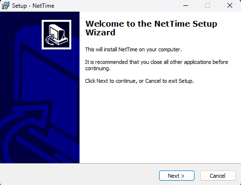

#### Pembahasan :

Layar sambutan ini adalah gerbang awal instalasi dan belum mengubah apa pun di komputer. Installer menyarankan aplikasi lain ditutup agar tidak ada berkas yang terkunci selama pemasangan. Tujuannya menyiapkan NetTime, alat yang dipakai pengguna Windows untuk mengerjakan sinkronisasi waktu pada Modul 3.1.

### 2. Menentukan Lokasi Instalasi

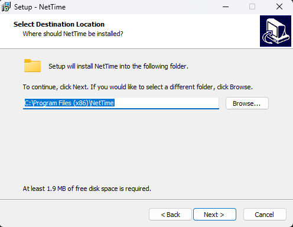

#### Pembahasan :
Installer menawarkan folder bawaan C:\Program Files (x86)\NetTime, dan folder (x86) menandakan NetTime adalah program 32-bit. Kebutuhan ruang hanya 1,9 MB, jadi program ini sangat ringan. Memakai lokasi bawaan adalah pilihan teraman karena sudah dikelola Windows dengan aturan izin yang jelas, sehingga tidak perlu diubah.

### 3. Menentukan Folder Start Menu

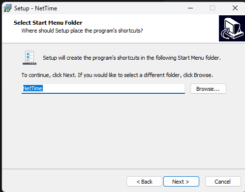

#### Pembahasan :
Layar ini hanya mengatur tempat pintasan NetTime di menu Start, dengan nama bawaan NetTime. Hasilnya, aplikasi mudah dibuka lagi lewat pencarian Windows untuk memeriksa status atau mengambil tangkapan layar laporan. Pengaturan ini tidak memengaruhi cara kerja sinkronisasi, sehingga nilai bawaan cukup dipakai.

### 4. Memilih “Install as Service”

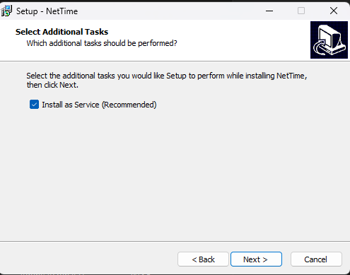

#### Pembahasan :
Dengan opsi ini NetTime dipasang sebagai Windows Service, yaitu program latar belakang yang berjalan otomatis tanpa perlu dibuka dan tetap aktif walau tidak ada pengguna yang login. Itu sebabnya opsi ini ditandai “Recommended”, karena jam sistem memang perlu dijaga terus-menerus. Konsekuensinya, menjalankan atau menghentikan service membutuhkan hak administrator, dan status “Mode: Windows Service” yang muncul nanti berasal dari pilihan ini.

### 5. Meninjau Ringkasan dan Memulai Instalasi

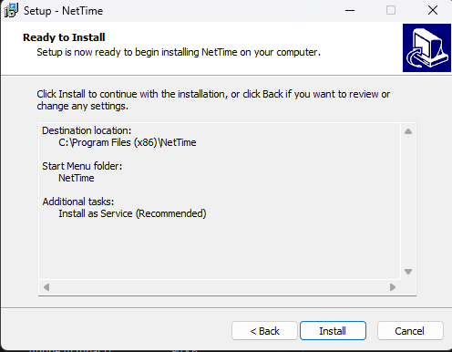

#### Pembahasan :
Layar “Ready to Install” merangkum tiga pilihan sebelumnya: lokasi, folder Start Menu, dan install as service. Ini kesempatan terakhir untuk kembali dengan tombol Back sebelum berkas disalin dan service didaftarkan, sebuah proses yang hanya memakan beberapa detik. Kebiasaan meninjau ringkasan sebelum mengeksekusi perlu dibiasakan, dan kalau gagal di tahap ini biasanya penyebabnya izin administrator.

### 6. Menyelesaikan Instalasi dan Menjalankan NetTime

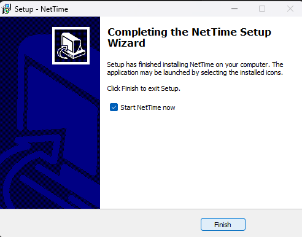

#### Pembahasan :
Layar penutup menandakan instalasi berhasil, dan kotak “Start NetTime now” langsung membuka jendela Network Time. Hasilnya, NetTime sudah terpasang dan siap dipakai. Namun instalasi yang sukses belum berarti waktu sudah tersinkronisasi, karena itu baru terlihat pada dua langkah berikutnya.

### 7. Mengamati Kondisi Awal (Sinkronisasi Belum Berjalan)

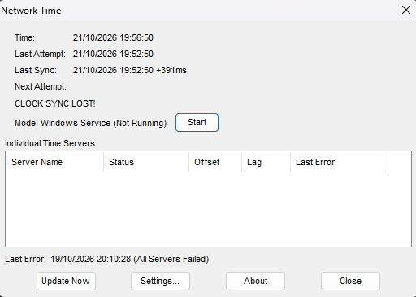

#### Pembahasan :
Tampilan “CLOCK SYNC LOST!” dengan “Windows Service (Not Running)” dan daftar server yang kosong menunjukkan bahwa service belum aktif sehingga belum ada status sinkron yang valid. Catatan Last Error “All Servers Failed” (19/10/2026 20:10:28) adalah riwayat percobaan lama yang gagal menjangkau server, sedangkan Last Sync +391ms menunjukkan jam sempat berbeda sekitar 391 milidetik. Tangkapan layar ini berguna sebagai pembanding “sebelum”, dan tombol Start mengaktifkan service; bila gagal, jalankan NetTime sebagai administrator dan pastikan internet tersambung.

### 8. Memeriksa Hasil Sinkronisasi dan Menjelaskan Prosesnya

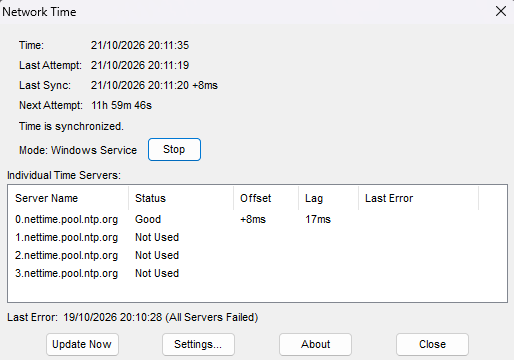

#### Pembahasan :

Setelah service berjalan, status berubah menjadi “Time is synchronized”, dengan server 0.nettime.pool.ntp.org berstatus Good, offset +8ms, dan lag 17ms. Prosesnya mengikuti protokol NTP: klien mencatat waktu kirim (T1), server mencatat waktu terima (T2) dan waktu balas (T3), lalu klien mencatat waktu terima balasan (T4), dan dari empat angka ini dihitung offset serta delay jaringan sebelum jam dikoreksi. Tiga server lain “Not Used” karena hanya cadangan, dan Next Attempt sekitar 12 jam berarti sinkronisasi diulang otomatis. Tujuannya menyelaraskan jam dengan acuan global, tetapi sisa selisih akibat delay jaringan tidak pernah nol, sehingga dibutuhkan vector clock yang tidak bergantung pada jam fisik.

## 3.2 Vector Clock

---

### 1. Menjalankan vclocks.py dan Membandingkannya dengan Perhitungan Manual

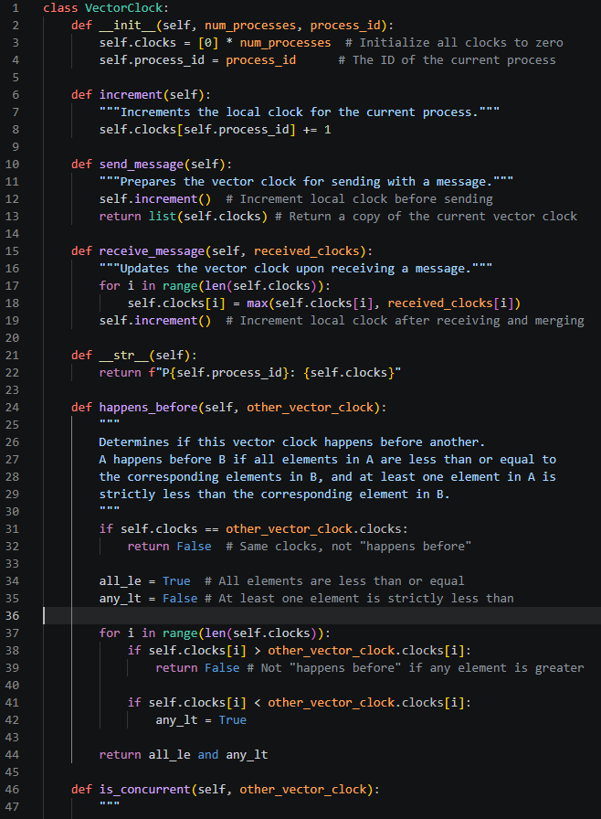
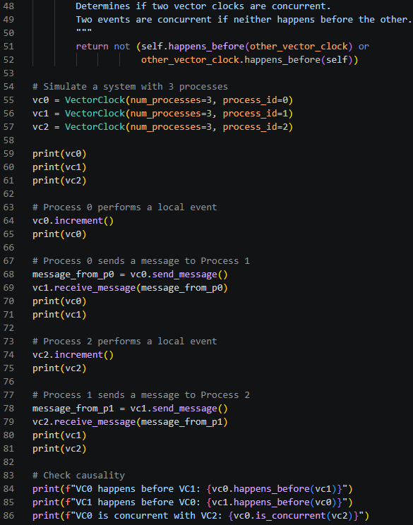

Output :

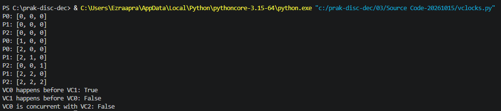

#### Pembahasan :

Class VectorClock menyimpan dua atribut, yaitu clocks berupa daftar berisi satu angka untuk setiap proses dalam sistem, dan process_id yang menandai pemilik objek. Pada __init__, daftar clocks diisi nol melalui [0] * num_processes, sehingga setiap proses dimulai tanpa kejadian apa pun. Method increment hanya menambah elemen pada posisi self.process_id, sehingga setiap proses hanya mencatat kejadiannya sendiri. Method ini dipanggil setiap kali terjadi kejadian lokal.

Pengiriman pesan ditangani oleh send_message, yang lebih dulu memanggil increment lalu mengembalikan salinan vektor melalui list(self.clocks). Urutan ini memastikan pesan sudah memuat kejadian pengiriman itu sendiri, sedangkan list() membuat salinan agar pengirim dan penerima tidak berbagi daftar yang sama. Penerimaan pesan ditangani oleh receive_message, yang mengambil nilai maksimum per elemen melalui max(self.clocks[i], received_clocks[i]) dalam perulangan for, lalu memanggil increment untuk mencatat penerimaan sebagai kejadian baru.

Method happens_before membandingkan dua vektor. Jika keduanya identik, hasilnya langsung False. Selanjutnya, perulangan memeriksa setiap elemen: bila ada elemen vektor pertama yang lebih besar, method langsung mengembalikan False, sedangkan bila ada elemen yang lebih kecil, any_lt diubah menjadi True. Hasil akhirnya bernilai True hanya jika tidak ada elemen yang lebih besar dan minimal satu elemen benar-benar lebih kecil. Method is_concurrent memanfaatkan happens_before dua arah dan mengembalikan True hanya jika tidak ada kejadian yang mendahului yang lain. Bagian utama program kemudian membuat tiga objek, menjalankan skenario kejadian lokal dan pengiriman pesan, lalu memanggil method pengujian untuk dicetak.

Tiga proses masing-masing memegang vektor tiga angka. Kejadian lokal atau pengiriman pesan menambah angka milik sendiri, sedangkan penerimaan pesan mengambil nilai maksimum per elemen lalu menambah angka sendiri. Keluaran program (P0 berakhir [2,0,0], P1 [2,2,0], P2 [2,2,2]) cocok dengan tabel hitungan manual, sehingga terbukti kode menjalankan algoritma dengan benar. Hasil “VC0 happens before VC1: True” dan “VC0 is concurrent with VC2: False” menunjukkan bahwa informasi dari P0 sampai ke P2 lewat P1, sehingga hubungan sebab-akibatnya tetap terdeteksi walau P0 dan P2 tidak berkomunikasi langsung.

### 2. Membuat Modul VectorClock (vector_clock.py)

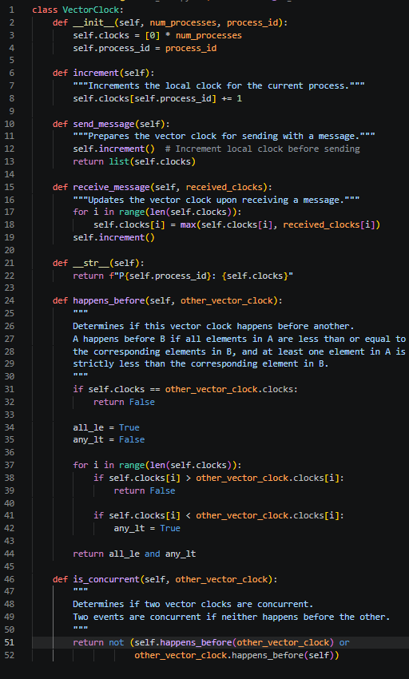

#### Pembahasan :

Pada tahap ini kita membuat file modul pertama, yaitu berkas Python yang hanya berisi definisi class VectorClock. Dalam Python, setiap file .py bisa berfungsi sebagai modul, yaitu kumpulan kode yang dapat diimpor oleh file lain. Dengan memisahkan class ke file sendiri, kita bisa memakai VectorClock di program mana pun tanpa harus menyalin ulang kodenya. Kode simulasi yang ada di bawah class sengaja tidak ikut disalin, karena jika ikut, setiap kali modul diimpor, skenario tiga proses akan ikut dijalankan dan mencetak keluaran yang tidak diperlukan.

Berkas ini ditempatkan di folder yang sama dengan vclocks.py supaya Python dapat menemukannya saat perintah import dijalankan. Python mencari modul di folder tempat skrip utama berada sebelum mencari di lokasi lain, sehingga penempatan ini memastikan impor berjalan tanpa konfigurasi tambahan. Hasil yang diharapkan adalah file vector_clock.py yang berisi method __init__, increment, send_message, receive_message, __str__, happens_before, dan is_concurrent. Jika file ini dijalankan langsung dengan python vector_clock.py, tidak akan muncul keluaran apa pun, dan itu wajar karena file ini hanya berisi definisi. Tujuan langkah ini adalah menyiapkan komponen inti yang akan diuji pada langkah berikutnya.

### 3. Memastikan Isi Modul Sesuai dengan Kode Asli

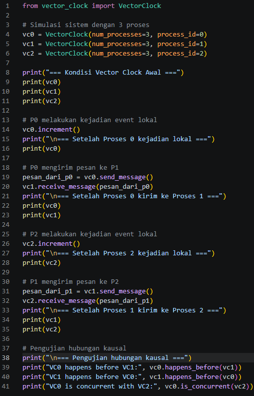

#### Pembahasan :

Langkah ini memastikan modul identik dengan class asli sehingga perilakunya tidak berubah. Pengecekan dilakukan secara manual karena satu perbedaan kecil, seperti indentasi yang bergeser atau salah ketik nama method, dapat menyebabkan error saat modul dipanggil dari file lain. Error seperti ini sering sulit dilacak karena pesannya tidak selalu menunjuk langsung ke penyebab aslinya. Dengan membandingkan dua file secara berdampingan, kita bisa menemukan perbedaan sebelum program dijalankan.

Pengecekan ini juga menegaskan batas tugas modul. Modul hanya boleh berisi class, sedangkan logika simulasi berada di file contoh, sehingga jika ada baris print yang tertinggal di modul, perilakunya akan berubah ketika diimpor. Setelah isi modul dipastikan benar, file contoh pada langkah berikutnya dapat menjalankan from vector_clock import VectorClock tanpa error dan menghasilkan keluaran yang sama dengan program asli. Kebiasaan memverifikasi kode sebelum digunakan juga penting untuk laporan, karena pembaca dapat yakin bahwa modul yang ditampilkan memang yang dijalankan.

Output :
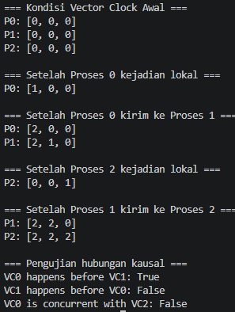

#### Pembahasan :

Bagian awal keluaran menunjukkan kondisi ketika ketiga proses baru dibuat, dan semua vektor masih berisi nol karena belum ada kejadian apa pun. Setelah Proses 0 melakukan kejadian lokal, hanya elemen pertamanya yang berubah menjadi 1, sehingga terlihat bahwa increment hanya menambah angka milik proses itu sendiri. Pada tahap pengiriman, P0 menjadi [2, 0, 0] karena send_message menambah angkanya sekali lagi sebelum mengirim salinannya. Di sisi penerima, P1 menjadi [2, 1, 0], yang berarti P1 mengambil nilai maksimum antara [0, 0, 0] dan [2, 0, 0], lalu menambah angka keduanya karena penerimaan pesan dihitung sebagai kejadian baru.

Bagian berikutnya memperlihatkan jejak yang sama dari sisi P2 dan P1. Ketika P2 melakukan kejadian lokal, vektornya menjadi [0, 0, 1] karena belum mengetahui kejadian dari proses lain. Saat P1 mengirim pesan ke P2, angka P1 bertambah dari [2, 1, 0] menjadi [2, 2, 0], dan itulah yang tercetak pada baris P1: [2, 2, 0]. P2 kemudian mengambil nilai maksimum antara [0, 0, 1] dan [2, 2, 0], yaitu [2, 2, 1], lalu menambah elemen ketiganya sehingga menjadi [2, 2, 2]. Hasil pengujian di bagian bawah membaca vektor-vektor akhir ini: VC0 happens before VC1: True karena [2, 0, 0] tidak memiliki elemen yang lebih besar dari [2, 2, 0] dan ada elemen yang lebih kecil, sedangkan VC1 happens before VC0: False karena elemen kedua P1 lebih besar. Adapun VC0 is concurrent with VC2: False menunjukkan bahwa walaupun P0 dan P2 tidak pernah berkomunikasi langsung, informasi dari P0 sudah sampai ke P2 lewat P1, sehingga keduanya tidak lagi dianggap concurrent.

## 3.3 Problem Tanpa Sinkronisasi

---

### 1. Menjalankan Program Multithreaded

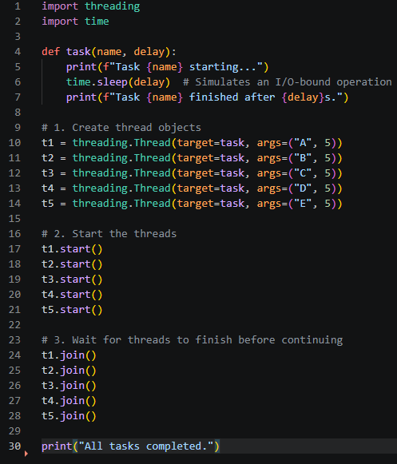

#### Pembahasan :

Program ini membuat lima thread (t1 sampai t5), dan masing-masing menjalankan fungsi task dengan nama berbeda (A sampai E) serta jeda yang sama, yaitu 5 detik. Setiap thread mencetak pesan “starting”, tidur selama 5 detik lewat time.sleep(delay), lalu mencetak pesan “finished”. Karena time.sleep melepas CPU selama menunggu, kelima thread dapat berjalan secara bersamaan. Akibatnya, total waktu eksekusi program sekitar 5 detik, bukan 25 detik seperti yang akan terjadi jika kelima tugas dijalankan satu per satu secara sekuensial. Pada program ini, t1.start() sampai t5.start() hanya memulai thread dan langsung kembali, sehingga kelimanya hampir pasti sudah berjalan sebelum ada yang selesai.

Bagian join() berfungsi sebagai titik tunggu bagi thread utama. Pemanggilan t1.join() hingga t5.join() menghentikan thread utama sampai masing-masing thread selesai, sehingga baris print("All tasks completed.") baru dijalankan setelah semua tugas usai. Urutan join tidak menentukan urutan selesainya thread, karena thread utama hanya menunggu setiap thread satu per satu, sedangkan thread-thread itu sendiri berjalan di waktu yang sama. Dari sinilah keluaran yang berbeda antar eksekusi muncul: urutan baris “starting” dan “finished” ditentukan oleh penjadwal sistem operasi dan kondisi komputer saat itu, bukan oleh urutan penulisan kode. Perbedaan inilah yang menjadi inti tugas nomor 1 modul ini, yaitu menunjukkan bahwa pola pikir sekuensial tidak dapat diterapkan pada program konkuren.

Hasil setelah program dijalankan 

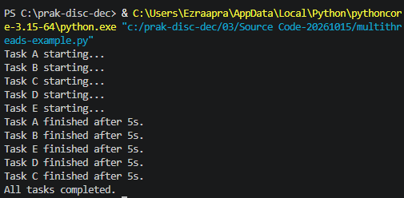

#### Pembahasan :

Keluaran yang dihasilkan pada eksekusi ini memperlihatkan dua pola yang berbeda. Pola pertama terlihat pada baris “starting”, yaitu A, B, C, D, dan E muncul berurutan. Hal ini terjadi karena thread utama memanggil start() satu per satu, dan pencetakan “starting” dilakukan di awal fungsi task sebelum thread masuk ke time.sleep. Pola kedua terlihat pada baris “finished”, yang muncul dengan urutan A, B, E, D, C. Urutan ini tidak sama dengan urutan start(), karena setelah masing-masing thread mulai tidur, penjadwal sistem operasi yang menentukan kapan setiap thread kembali dan mencetak pesannya. Karena kelima thread memiliki jeda yang sama, selisih waktu selesainya sangat kecil dan ditentukan oleh kondisi sistem pada saat itu.

Semua baris “finished” menunjukkan “after 5s”, yang menandakan setiap thread memang menunggu tepat lima detik. Karena seluruh thread berjalan bersamaan, total waktu eksekusi hanya sekitar lima detik, bukan dua puluh lima detik seperti jika kelima tugas dijalankan satu per satu. Baris “All tasks completed.” muncul paling akhir karena pemanggilan join() membuat thread utama menunggu setiap thread selesai terlebih dahulu. Dengan demikian, keluaran ini membuktikan bahwa urutan penulisan kode tidak sama dengan urutan eksekusi, dan bahwa join() hanya menjamin urutan penyelesaian program secara keseluruhan, bukan urutan selesainya setiap tugas.

### 3.3.1 Data Race / Race Conditions

### race-conditions-01

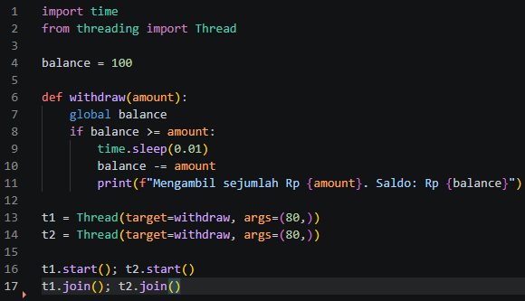

#### Pembahasan :

Program ini membuat dua thread, t1 dan t2, yang sama-sama memanggil fungsi withdraw(80) dengan saldo awal Rp 100. Pada fungsi tersebut, thread pertama memeriksa balance >= amount, yang bernilai benar karena saldo masih Rp 100. Sebelum sempat mengurangi saldo, thread tersebut tidur selama 0,01 detik lewat time.sleep(0.01). Dalam jeda singkat itu, thread kedua juga masuk ke fungsi, memeriksa saldo yang masih Rp 100, dan mendapati kondisinya tetap benar. Akibatnya, kedua thread lolos pemeriksaan dan keduanya melakukan penarikan.

Output setlah program dijalankan

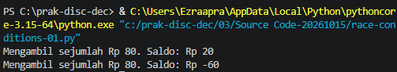

#### Pembahasan :

Keluaran pada terminal memperlihatkan hasilnya: “Mengambil sejumlah Rp 80. Saldo: Rp 20” dan “Mengambil sejumlah Rp 80. Saldo: Rp -60”. Baris pertama benar, karena saldo menjadi 100 - 80 = 20. Baris kedua salah, karena thread kedua mengurangi saldo dari 20 menjadi -60 tanpa memeriksa ulang kondisi. Hal ini terjadi karena pengecekan dan pengurangan saldo tidak dilakukan sebagai satu kesatuan, sehingga thread lain bisa menyelinap di antaranya. Inilah yang disebut race condition, yaitu hasil program bergantung pada urutan eksekusi thread yang tidak dapat dikendalikan.

Visualisasi mengapa terjadi data race /race conditions

#### Pembahasan :

Visualisasi ini memperlihatkan bagaimana dua thread, t1 dan t2, bekerja pada satu variabel yang sama, yaitu balance yang berada di memori bersama dengan nilai awal Rp 100. Keduanya menjalankan fungsi withdraw(80) secara bersamaan, dan masing-masing melewati enam tahap: membaca saldo, memeriksa kondisi, masuk ke blok if, menghitung saldo baru, menulis hasilnya ke memori, lalu mencetak pesan.

Masalah muncul pada tahap pembacaan dan penulisan. Kedua thread membaca nilai yang sama, yaitu 100, karena belum ada yang sempat menulis perubahan. Keduanya lolos pengecekan 100 >= 80, lalu sama-sama menghitung 100 - 80 = 20. Thread pertama menulis 20 ke memori, kemudian thread kedua menulis 20 juga, sehingga penulisan dari thread pertama tertimpa tanpa pernah diperhitungkan. Padahal seharusnya penarikan kedua dihitung dari saldo 20, yang hasilnya -60 dan seharusnya ditolak. Kejadian seperti ini disebut lost update, yaitu satu pembaruan hilang karena tertimpa pembaruan lain.

Contoh urutan pada tabel menunjukkan bahwa masalah ini tidak selalu terjadi dengan cara yang sama setiap kali. Jika thread kedua membaca saldo setelah thread pertama selesai menulis, hasilnya akan benar. Karena itu, keluaran program bisa berbeda antar eksekusi, dan hal ini sejalan dengan catatan di bagian bawah bahwa hasil akhir tidak dijamin selalu sama. Solusi untuk mencegah kejadian ini adalah membungkus seluruh proses pengecekan dan pengurangan saldo dengan lock, seperti yang dilakukan pada race-conditions-02.py, sehingga hanya satu thread yang boleh mengakses balance pada satu waktu.

### race-conditions-02

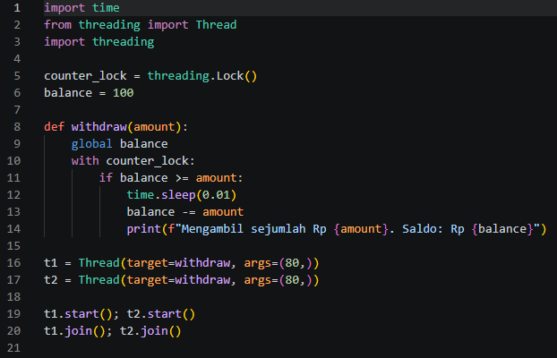

#### Pembahasan :

Dua thread sama-sama mencoba menarik uang Rp 80 dari saldo Rp 100. Kuncinya ada di counter_lock = threading.Lock() dan blok with counter_lock:. Blok itu membuat pengecekan saldo (if balance >= amount) dan pengurangan saldo (balance -= amount) menjadi satu kesatuan yang tidak bisa disela thread lain. Tujuannya mencegah race condition, yaitu hasil program yang bergantung pada siapa yang kebetulan lebih dulu dijalankan.

Output program :

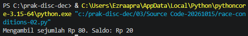

#### Pembahasan :

Hanya ada satu baris output, dan itu memang benar. Thread pertama yang masuk memegang lock, melihat saldo 100 ≥ 80, lalu mengurangi saldo menjadi 20. Thread kedua harus menunggu di with counter_lock. Setelah giliran thread kedua tiba, saldo sudah 20, sehingga syarat balance >= amount salah dan penarikan tidak diproses. Tanpa lock (seperti di race-conditions-01.py), kedua thread bisa lolos pengecekan sebelum saldo dikurangi, dan saldo akhir jadi minus (−60). Hasil ini yang membuktikan bahwa lock berfungsi.

### 3.3.2 Deadlock

### deadlock-01

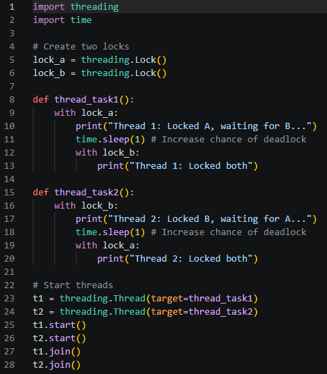

#### Pembahasan :

Ada dua lock, lock_a dan lock_b. Thread 1 mengunci A lalu meminta B, sedangkan Thread 2 mengunci B lalu meminta A. Urutannya terbalik, dan time.sleep(1) sengaja diberi supaya kedua thread punya waktu memegang lock pertamanya sebelum meminta lock kedua. Tujuan kode ini adalah menunjukkan terjadinya deadlock dengan sengaja.

Output :

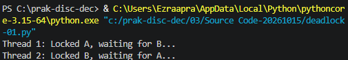

#### Pembahasan :

Output berhenti di dua baris itu karena kedua thread saling menunggu selamanya. Thread 1 memegang A dan menunggu B, sementara B dipegang Thread 2 yang justru menunggu A. Situasi ini memenuhi kondisi deadlock: mutual exclusion (lock hanya bisa dipegang satu thread), hold and wait (memegang satu lock sambil menunggu yang lain), no preemption (lock tidak bisa direbut paksa), dan circular wait (saling menunggu membentuk lingkaran).

### deadlock-02

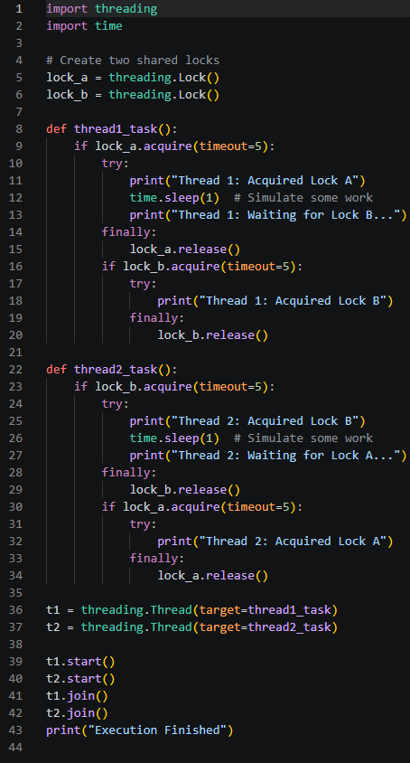

#### Pembahasan :

Perbedaan terbesar dengan versi sebelumnya ada di dua hal. Pertama, lock diminta dengan acquire(timeout=5), jadi thread tidak menunggu selamanya. Kedua, dan ini yang paling menentukan, lock pertama dilepas lewat finally: lock_a.release() sebelum thread meminta lock kedua. Dengan begitu tidak ada thread yang memegang satu lock sambil menunggu lock lain, sehingga kondisi hold and wait dan circular wait tidak terbentuk.

Output :

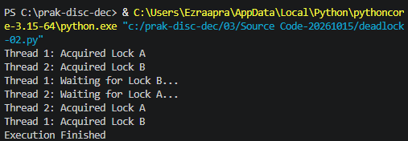

#### Pembahasan :

Program selesai dengan Execution Finished, artinya tidak ada deadlock. Kedua thread sempat mengambil lock pertamanya, melepaskannya setelah “bekerja” 1 detik, lalu mengambil lock kedua yang sudah bebas. Perlu dicatat bahwa pada versi ini tidak ada thread yang pernah memegang kedua lock sekaligus. Kalau pekerjaanmu memang membutuhkan dua lock bersamaan, solusi yang lazim adalah memakai urutan pengambilan lock yang sama di semua thread.

