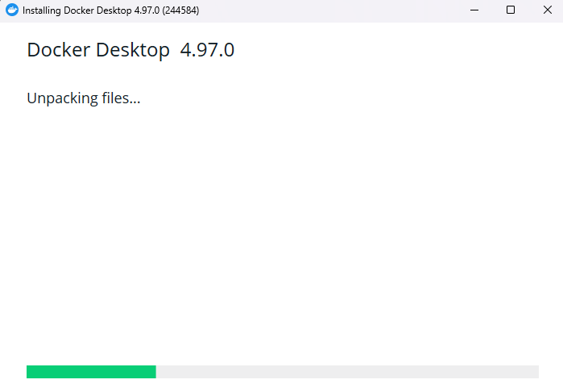
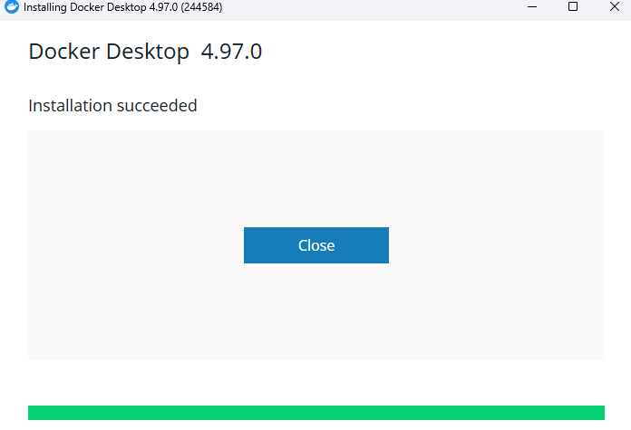
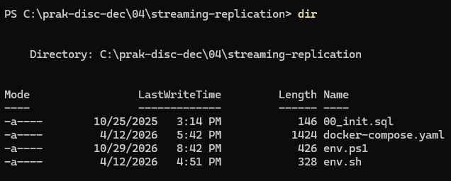
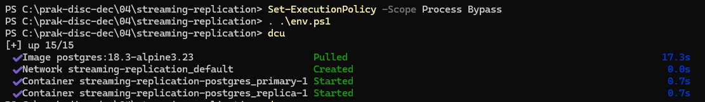
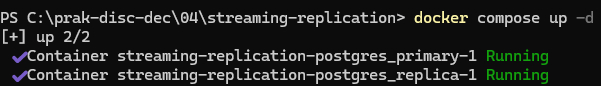

# Praktik 4 - Sinkronisasi pada Sistem Terdistribusi

---

Judul Modul : Sinkronisasi pada Sistem Terdistribusi  <br>
Mata Kuliah : __Praktikum Sistem Terdistribusi dan Terdesentralisasi__


| Field | Keterangan |
| :--- | :--- |
| **Nama** | Ezra Adyatma Pranantio |
| **NIM** | 255410002 |

---

## 📌 Tujuan Praktikum
1. Menyiapkan lingkungan Docker pada Windows untuk menjalankan layanan
basis data dalam container.

2. Membuat dan menguji streaming replication PostgreSQL, dengan
satu server primary dan satu server replica.

3. Mengamati status replica dan membuktikan bahwa perubahan data pada
primary diteruskan ke replica.

4. Memahami proses promosi replica menjadi primary ketika primary tidak tersedia.

5. Menjalankan cluster tiga node Apache Ignite dan menginisialisasi
cluster tersebut.

6. Menjalankan perintah SQL serta memeriksa bahwa tabel dapat dilihat
melalui node-node dalam cluster Ignite.


## 📖 Dasar Teori

**Konsep Konsistensi dan Duplikasi Data dalam Sistem Terdistribusi**

<p align ="justify">Konsistensi dan replikasi data merupakan konsep penting dalam sistem terdistribusi untuk menjaga kesesuaian dan ketersediaan informasi pada beberapa server. Replikasi dilakukan dengan menyalin data dari satu server ke server lain sehingga data tetap dapat diakses dan risiko kehilangan layanan dapat dikurangi. Konsistensi berkaitan dengan kesesuaian data antarserver setelah perubahan dilakukan, sedangkan mekanisme replikasi menentukan bagaimana perubahan tersebut disebarkan.


**Mekanisme Replikasi Data melalui Arsitektur Primary-Replica**

<p align ="justify">Replikasi Primary-Replica menggunakan satu server utama (primary) untuk menerima perubahan data, sedangkan server replica mengikuti perubahan tersebut. Pada PostgreSQL, streaming replication memungkinkan perubahan dikirimkan dari primary ke replica melalui aliran catatan transaksi. Mekanisme ini membantu menjaga salinan data tetap mutakhir dan mendukung pembagian beban baca sesuai konfigurasi sistem.


**Komponen Pendukung Pencatatan dan Sinkronisasi Replikasi PostgreSQL**

<p align ="justify">Write-Ahead Logging (WAL) merupakan mekanisme PostgreSQL yang mencatat perubahan data sebelum perubahan tersebut diterapkan secara permanen pada berkas data. Log Sequence Number (LSN) digunakan sebagai penanda posisi dalam aliran WAL untuk melacak perkembangan pengiriman dan penerapan perubahan. Sementara itu, replication slot membantu memastikan catatan WAL yang masih dibutuhkan oleh replica tidak dihapus terlalu dini, sehingga mendukung kelangsungan proses replikasi.

**Ketersediaan Layanan, Pengalihan Server, dan Konflik Peran dalam Sistem Terdistribusi**

<p align ="justify">High Availability merupakan pendekatan untuk menjaga layanan tetap tersedia ketika terjadi gangguan pada server. Failover adalah proses pengalihan peran layanan ke server cadangan ketika server utama mengalami kegagalan. Namun, jika server utama dan server cadangan sama-sama aktif sebagai pemimpin tanpa koordinasi yang tepat, dapat terjadi kondisi split-brain yang berisiko menimbulkan perbedaan data. Oleh karena itu, mekanisme pemantauan, promosi replica, dan pengendalian peran server perlu dirancang dengan baik.

**Penerapan Cluster Terdistribusi melalui Apache Ignite dan Arsitektur Master-Master**

<p align ="justify">Apache Ignite merupakan platform komputasi terdistribusi yang mendukung penyimpanan dan pemrosesan data dalam cluster. Dalam arsitektur master-master, beberapa node dapat menerima perubahan data sesuai konfigurasi sistem, berbeda dengan pola primary-replica yang berpusat pada satu server utama. Cluster Apache Ignite mengoordinasikan node-node yang tergabung agar data dan layanan dapat digunakan secara terdistribusi. Perilaku replikasi dan konsistensi aktual bergantung pada arsitektur serta konfigurasi cluster yang digunakan.

**Pemanfaatan Container Docker untuk Implementasi Sistem Terdistribusi**

<p align ="justify">Docker merupakan platform untuk menjalankan aplikasi dalam container yang terisolasi beserta dependensinya. Dalam praktikum sistem terdistribusi, Docker memudahkan pembuatan beberapa server atau node dalam satu komputer melalui konfigurasi layanan dan jaringan. Pada Windows, Docker Desktop dapat menggunakan Windows Subsystem for Linux 2 (WSL 2) sebagai backend untuk menjalankan container Linux. Dengan demikian, lingkungan PostgreSQL dan Apache Ignite dapat disiapkan serta diuji secara lebih terstruktur tanpa harus memasang setiap layanan secara langsung pada sistem operasi utama.
<br><br>


# 📝Pembahasan Praktikum

## 4.1 Streaming Replication Menggunakan PostgreSQL

---

### 4.1.1 Prasyarat

### 1. Melakukan Instalasi Docker


#### Pembahasan :

<p align ="justify"> Gambar tersebut menunjukkan tahap konfigurasi instalasi Docker Desktop pada sistem operasi Windows. Pada tahap ini, dipilih opsi Per-user installation (Recommended) agar aplikasi dipasang untuk pengguna yang sedang aktif, dengan backend WSL 2 yang memungkinkan Docker menjalankan container Linux di dalam Windows. Selain itu, opsi Add shortcut to desktop dicentang untuk menambahkan pintasan Docker Desktop pada desktop agar lebih mudah diakses. Setelah konfigurasi dipastikan sesuai, tombol OK dapat ditekan untuk melanjutkan instalasi, dengan catatan bahwa fitur WSL 2 dan Virtual Machine Platform harus sudah aktif agar proses instalasi berjalan dengan baik.
<br><br>



#### Pembahasan :

<p align ="justify">Gambar pertama menunjukkan proses instalasi Docker Desktop versi 4.97.0 yang ditandai dengan aktivitas Unpacking files. Pada tahap ini, installer mengekstrak dan menyiapkan berkas yang diperlukan agar Docker Desktop dapat digunakan. Proses ini merupakan bagian dari persiapan lingkungan praktikum karena Modul 4 mensyaratkan instalasi Docker sebelum konfigurasi dan pengoperasian sistem replikasi dilakukan.
<br><br>



#### Pembahasan :

<p align ="justify">Gambar kedua menunjukkan bahwa proses instalasi Docker Desktop telah berhasil, sebagaimana ditunjukkan oleh keterangan Installation succeeded dan indikator kemajuan yang telah mencapai 100%. Keberhasilan instalasi ini menandakan bahwa tahap pemasangan aplikasi telah selesai. Docker Desktop selanjutnya dapat digunakan untuk menjalankan dan mengelola container sebagai lingkungan pendukung praktikum sistem terdistribusi.

### Memeriksa Versi dan Lingkungan

---

**Melakukan pengecekan versi Docker dan Compose**

__Versi Docker__


#### Pembahasan :

<p align ="justify">Pemeriksaan versi Docker dilakukan melalui Windows PowerShell menggunakan perintah docker --version. Berdasarkan hasil pengujian, diperoleh Docker versi 29.9.2 dengan build a82e528. Informasi tersebut menunjukkan bahwa terminal dapat mengenali perintah Docker dan menampilkan versi yang terpasang. Dalam Modul 4, Docker digunakan untuk menjalankan dan mengelola container yang menjadi lingkungan praktikum replikasi PostgreSQL maupun Apache Ignite.

__Versi Compose__


#### Pembahasan :

<p align ="justify">Pemeriksaan versi Docker Compose dilakukan melalui Windows PowerShell menggunakan perintah docker compose version. Hasil pengujian menunjukkan bahwa Docker Compose yang terpasang adalah versi v5.6.1. Docker Compose berfungsi menjalankan beberapa layanan berdasarkan konfigurasi dalam berkas YAML, sehingga memudahkan pengelolaan container dalam satu lingkungan praktikum. Sesuai Modul 4, komponen ini digunakan untuk menjalankan layanan PostgreSQL beserta server replikanya atau membangun klaster Apache Ignite. Dengan demikian, pemeriksaan versi Docker Compose menjadi langkah awal untuk memastikan kesiapan perangkat lunak sebelum konfigurasi praktikum dilaksanakan.

**Melakukan Pengecekan Info**


#### Pembahasan :
<p align ="justify">Berdasarkan output perintah docker info pada gambar pertama, Docker CLI telah terpasang dengan versi 29.9.2, Docker Compose versi 5.6.1, dan Docker Desktop versi 4.97.0. Output tersebut juga menampilkan berbagai plugin Docker yang mendukung pengelolaan container, pembuatan image, serta konfigurasi lingkungan Docker. Context desktop-linux menunjukkan bahwa Docker diarahkan ke lingkungan Linux melalui Docker Desktop. Hasil ini menunjukkan bahwa komponen Docker pada sisi client telah tersedia dan dapat dikenali oleh PowerShell.

<p align ="justify">Pada gambar kedua, bagian Server menampilkan informasi Docker Engine dengan versi 29.9.2. Lingkungan Docker menggunakan sistem operasi Linux berbasis WSL 2 dengan arsitektur x86_64, kapasitas memori sekitar 11,54 GiB, dan 20 CPU yang terdeteksi. Informasi tersebut menunjukkan bahwa Docker Engine telah berhasil diakses dan lingkungan container siap digunakan. Namun, jumlah container dan image masih menunjukkan nilai nol, yang berarti belum terdapat container maupun image yang tercatat pada lingkungan Docker tersebut. Oleh karena itu, langkah berikutnya adalah menyiapkan konfigurasi dan menjalankan container yang diperlukan untuk praktikum replikasi data menggunakan PostgreSQL dan Apache Ignite.

## 4.1.2 Struktur Direktori dan FIle


Berkas yang dibutuhkan untuk menjalankan praktikum ini meliputi beberapa file berikut :

```text
streaming-replication/
├── 00_init.sql
├── docker-compose.yaml
└── env.sh

1 directory, 3 files
```
<br><br>
Seperti ini struktur direktori setelah dibuat


#### Pembahasan :

<p align ="justify">Gambar tersebut menunjukkan struktur direktori streaming-replication yang digunakan dalam Praktikum Modul 4 tentang konsistensi dan replikasi pada sistem terdistribusi. Direktori ini memiliki tiga file utama, yaitu 00_init.sql, docker-compose.yaml, dan env.sh. File 00_init.sql berisi perintah SQL untuk membuat pengguna yang memiliki hak replikasi dan membuat replication slot. File docker-compose.yaml mengatur konfigurasi container PostgreSQL, sedangkan env.sh berisi alias untuk mempermudah penggunaan perintah Docker melalui terminal Linux. Ketiga file tersebut saling mendukung proses konfigurasi dan pengoperasian replikasi database PostgreSQL.

_00_init.sql_ :


#### Pembahasan :

<p align ="justify">Proses persiapan replikasi PostgreSQL dilakukan melalui file 00_init.sql yang berisi dua perintah SQL utama. Perintah CREATE USER replicator WITH REPLICATION ENCRYPTED PASSWORD 'replicator_password' digunakan untuk membuat pengguna yang memiliki hak replikasi dengan kata sandi terenkripsi. Pengguna tersebut berfungsi sebagai akun yang digunakan server replica untuk terhubung ke server primary. Selanjutnya, perintah SELECT pg_create_physical_replication_slot('replication_slot') digunakan untuk membuat replication slot bernama replication_slot. Slot ini membantu PostgreSQL mempertahankan catatan WAL yang masih diperlukan oleh proses replikasi agar perubahan data dapat dikirimkan ke server replica.

_docker-compose.yaml_ :


#### Pembahasan :

<p align ="justify">Gambar tersebut menampilkan konfigurasi Docker Compose untuk menjalankan dua container PostgreSQL, yaitu postgres_primary dan postgres_replica. Konfigurasi ini menggunakan image PostgreSQL 18.3 Alpine serta menetapkan pengaturan koneksi, autentikasi, port, dan variabel lingkungan untuk masing-masing container. Server primary menggunakan port 5432 dan berfungsi menerima operasi baca maupun tulis, sedangkan server replica menggunakan port 5433 pada Windows untuk mengakses layanan PostgreSQL di dalam container melalui port 5432. Pada server primary, parameter seperti wal_level=replica, max_wal_senders=10, dan max_replication_slots=10 mendukung pengiriman data untuk proses replikasi. Sementara itu, server replica menjalankan pg_basebackup untuk mengambil salinan awal data dari primary, kemudian menggunakan konfigurasi hasil proses tersebut untuk memulai PostgreSQL sebagai server standby. Dengan konfigurasi ini, perubahan data pada primary dapat diteruskan ke replica secara otomatis.

_env.sh_ :


#### Pembahasan :

<p align ="justify">Untuk mempermudah pengelolaan container selama praktikum, file env.sh menyediakan beberapa alias yang mewakili perintah Docker. Alias dcu digunakan untuk menjalankan layanan melalui Docker Compose, sedangkan dcd digunakan untuk menghentikan layanan berdasarkan konfigurasi yang digunakan. Alias dps berfungsi menampilkan daftar container yang sedang berjalan. Selain itu, alias der dan dep digunakan untuk membuka terminal container replica dan primary, sementara dlr dan dlp digunakan untuk menampilkan log dari masing-masing container. Penggunaan alias tersebut membantu mengurangi penulisan perintah yang panjang dan mempercepat proses pemeriksaan layanan. Karena file env.sh menggunakan sintaks Bash, pengguna Windows 11 dapat menjalankannya melalui Ubuntu pada WSL jika ingin menggunakan alias tersebut sesuai dengan petunjuk modul.

### Mencoba Menjalankan Docker Compose

**Pemeriksaan Struktur Direktori dan File Konfigurasi Streaming Replication PostgreSQL pada Windows PowerShell**



#### Pembahasan :

<p align ="justify">Berdasarkan gambar tersebut, perintah dir dijalankan melalui PowerShell untuk menampilkan daftar file yang terdapat dalam direktori C:\prak-disc-dec\04\streaming-replication. Hasilnya menunjukkan empat file, yaitu 00_init.sql, docker-compose.yaml, env.ps1, dan env.sh. File 00_init.sql berisi perintah SQL untuk menyiapkan kebutuhan replikasi PostgreSQL, sedangkan docker-compose.yaml digunakan untuk mengatur konfigurasi layanan server primary dan replica. Keberadaan file-file tersebut menunjukkan bahwa direktori praktikum telah disiapkan sebagai tempat penyimpanan konfigurasi yang diperlukan untuk menjalankan streaming replication pada Modul 4.

<p align ="justify">Penambahan file env.ps1 bertujuan untuk menyesuaikan penggunaan perintah praktikum dengan sistem operasi Windows. File env.sh menggunakan sintaks Bash yang umumnya dijalankan melalui Linux atau WSL, sedangkan file env.ps1 dapat berisi perintah dan fungsi yang sesuai dengan PowerShell. Dengan adanya file env.ps1, perintah yang sering digunakan, seperti menjalankan dan menghentikan container, memeriksa daftar container, serta melihat log PostgreSQL, dapat dibuat menjadi lebih praktis di lingkungan Windows. Penyesuaian ini membantu pengguna mengikuti tahapan praktikum tanpa harus selalu menggunakan perintah Linux. Namun, isi file env.ps1 perlu diperiksa terlebih dahulu untuk memastikan bahwa perintah dan fungsi yang tersedia sesuai dengan kebutuhan praktikum.


**Mengaktifkan Konfigurasi PowerShell dan Menjalankan Streaming Replication PostgreSQL**



#### Pembahasan :

<p align ="justify">Tahap awal pada gambar dilakukan dengan menjalankan perintah Set-ExecutionPolicy -Scope Process Bypass untuk mengizinkan eksekusi skrip PowerShell selama sesi terminal berlangsung. Selanjutnya, perintah . .\env.ps1 digunakan untuk memuat fungsi atau alias yang telah didefinisikan dalam file env.ps1 ke sesi PowerShell yang sedang aktif. Setelah konfigurasi tersebut dimuat, perintah dcu dijalankan sebagai singkatan untuk mengaktifkan layanan Docker Compose. Hasil eksekusi menunjukkan bahwa Docker berhasil mengambil image PostgreSQL 18.3-alpine3.23, membuat jaringan streaming-replication_default, serta menjalankan container primary dan replica dengan status Started. Proses ini menunjukkan bahwa konfigurasi lingkungan Windows telah digunakan untuk mempermudah pengoperasian layanan PostgreSQL sesuai dengan kebutuhan praktikum Modul 4.


**Menjalankan Container PostgreSQL Menggunakan Docker Compose**



#### Pembahasan :

<p align ="justify">Proses menjalankan layanan PostgreSQL dilakukan dengan mengetikkan perintah docker compose up -d pada PowerShell di direktori streaming-replication. Perintah tersebut digunakan untuk menjalankan layanan yang telah didefinisikan dalam file docker-compose.yaml di latar belakang. Berdasarkan hasil pada gambar, Docker berhasil menjalankan dua container, yaitu streaming-replication-postgres_primary-1 dan streaming-replication-postgres_replica-1, dengan status Running. Hal ini menunjukkan bahwa kedua container telah berjalan sesuai konfigurasi yang ditentukan. Tahap ini menjadi langkah awal dalam membangun mekanisme streaming replication PostgreSQL pada Modul 4, yaitu menyiapkan server primary dan replica agar dapat menjalankan proses replikasi data.
