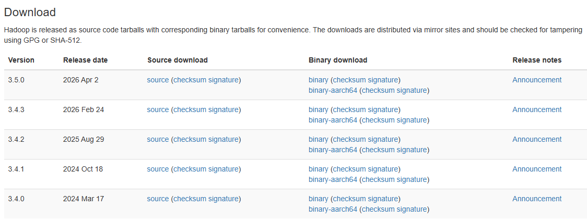

# Praktik 6 - Distributed File System - HDFS

---

Judul Modul : Distributed File System - HDFS   
Mata Kuliah : __Praktikum Sistem Terdistribusi dan Terdesentralisasi__

| Field | Keterangan |
| :--- | :--- |
| **Nama** | Ezra Adyatma Pranantio |
| **NIM** | 255410002 |

---

## 📌 Tujuan Praktikum

1. Memahami konsep dasar Distributed File System (DFS) dan peran Hadoop Distributed File System (HDFS) dalam penyimpanan data terdistribusi.

2. Mengetahui dan memahami proses instalasi serta konfigurasi Apache Hadoop sebagai lingkungan untuk menjalankan HDFS.

3. Memahami fungsi komponen dan layanan pendukung Hadoop, seperti JDK, SSH, dan PDSH dalam menjalankan sistem terdistribusi.

4. Mampu melakukan konfigurasi HDFS, mulai dari pengaturan file konfigurasi, penentuan direktori penyimpanan, hingga proses format NameNode dan menjalankan daemon HDFS.

5. Mampu menerapkan operasi dasar HDFS, seperti membuat direktori dan menyalin file ke dalam sistem penyimpanan terdistribusi.

## 📖 Dasar Teori

Distributed File System (DFS) merupakan sistem penyimpanan berkas yang memungkinkan data disimpan dan dikelola pada beberapa komputer atau node yang saling terhubung melalui jaringan. Sistem ini dirancang untuk menangani kebutuhan penyimpanan data dalam jumlah besar dengan membagi pengelolaan data ke beberapa perangkat. Melalui konsep penyimpanan terdistribusi, pengguna dapat mengakses dan mengelola data secara terpusat meskipun data tersebut berada pada lokasi penyimpanan yang berbeda. DFS juga mendukung skalabilitas sistem sehingga kapasitas penyimpanan dapat dikembangkan sesuai kebutuhan.

Apache Hadoop merupakan framework yang digunakan untuk mengelola dan memproses data berukuran besar dalam lingkungan terdistribusi. Salah satu komponen utamanya adalah Hadoop Distributed File System (HDFS), yaitu sistem penyimpanan yang memungkinkan file berukuran besar dibagi menjadi beberapa blok dan didistribusikan ke berbagai node. HDFS memiliki dua komponen utama, yaitu NameNode dan DataNode. NameNode bertanggung jawab mengelola metadata, struktur direktori, serta informasi lokasi blok data, sedangkan DataNode bertugas menyimpan blok data secara langsung dan melayani proses pembacaan maupun penulisan file.

Dalam menjalankan Apache Hadoop, diperlukan beberapa perangkat lunak pendukung, seperti Java Development Kit (JDK), Secure Shell (SSH), dan Parallel Distributed Shell (PDSH). JDK berfungsi menyediakan lingkungan Java yang dibutuhkan Hadoop agar dapat dijalankan, sedangkan SSH digunakan untuk mendukung komunikasi jarak jauh yang aman antar-node. Sementara itu, PDSH memungkinkan administrator menjalankan perintah secara bersamaan pada beberapa komputer. Kombinasi perangkat lunak tersebut mendukung proses komunikasi, pengelolaan, dan pengoperasian layanan Hadoop dalam lingkungan sistem terdistribusi.

Konfigurasi Hadoop dilakukan melalui beberapa file utama, yaitu hdfs-site.xml, core-site.xml, mapred-site.xml, dan yarn-site.xml. Setiap file memiliki fungsi konfigurasi yang berbeda, seperti menentukan jumlah replikasi data, alamat sistem file HDFS, pengaturan MapReduce, serta pengelolaan sumber daya melalui YARN. Setelah konfigurasi selesai, NameNode perlu diformat untuk menginisialisasi metadata dan struktur penyimpanan HDFS. Selanjutnya, daemon HDFS dijalankan agar layanan penyimpanan dapat beroperasi dan dipantau melalui antarmuka web yang disediakan oleh Hadoop.

Setelah HDFS berhasil dijalankan, pengguna dapat melakukan berbagai operasi pengelolaan file, seperti membuat direktori, menyalin file dari penyimpanan lokal ke HDFS, serta menampilkan dan mengelola data yang tersimpan. Salah satu penerapannya adalah membuat direktori datasets pada direktori pengguna dan menyalin beberapa file berformat CSV ke dalamnya. Kegiatan tersebut menunjukkan bagaimana HDFS digunakan sebagai media penyimpanan data terdistribusi serta memberikan pemahaman mengenai proses pengelolaan file menggunakan perintah-perintah Hadoop. Dengan demikian, pemahaman terhadap konsep DFS, komponen Hadoop, konfigurasi sistem, dan operasi file menjadi dasar penting dalam mempelajari penerapan teknologi penyimpanan data terdistribusi.

# 📝Pembahasan Praktikum

## 1. Persyaratan Software

_Untuk melakukan praktik ini diperlukan JDK 17 atau 21 yang akan digunakan. Untuk JDK 17 digunakan proses kompilasi Apache Hadoop harus menggunakan JDK 17. Kemudian JDK 17 ataupun 21 dapat digunakan pada sisi server, untuk sisi client bisa menggunakan kedua versi tersebut._

#### Pembahasan :

Berdasarkan spesifikasi kebutuhan perangkat lunak pada modul praktikum, operasionalisasi Apache Hadoop 3.5.0 mensyaratkan penggunaan Java Development Kit (JDK) versi 17 atau 21 sebagai lingkungan eksekusi Java Virtual Machine (JVM). Pada tahapan kompilasi kode sumber (source code build) Apache Hadoop, penggunaan JDK 17 bersifat wajib karena seluruh dependensi pustaka build serta plugin kompilasi internal distandardisasi terhadap spesifikasi bytecode dan aturan enkapsulasi modul pada Java 17. Sebaliknya, pada lingkungan runtime yang menjalankan paket distribusi biner (pre-compiled binary), sistem mendukung penggunaan JDK 17 maupun JDK 21 berkat prinsip kompatibilitas mundur (backward compatibility) pada arsitektur JVM. Fleksibilitas dukungan kedua versi tersebut berlaku secara menyeluruh baik pada sisi server—yang menjalankan daemon NameNode, DataNode, ResourceManager, dan NodeManager—maupun pada sisi client yang mengeksekusi utilitas baris perintah dan pengiriman pekerjaan MapReduce. Dalam implementasi praktikum ini secara native pada sistem operasi Windows, digunakan JDK 17 (jdk-17.0.12) yang didefinisikan pada variabel lingkungan JAVA_HOME serta berkas hadoop-env.cmd untuk menjamin konsistensi eksekusi proses antara layanan server dan utilitas client.

## 2. Unduh Apache Hadoop

#### Pembahasan :

Dalam implementasi praktikum pada sistem operasi Windows, dipilih paket distribusi binary standar (arsitektur x64) dibandingkan paket binary yang dikhususkan bagi prosesor berbasis ARM. Pemilihan arsip biner ini memungkinkan sistem langsung mengeksekusi pustaka kelas Java yang telah terkompilasi tanpa memerlukan proses pembangunan ulang kode sumber melalui Apache Maven. Setelah arsip biner berhasil diunduh dan diekstrak ke direktori lokal, komponen pustaka pendukung interoperabilitas Windows seperti winutils.exe dan hadoop.dll diintegrasikan ke dalam sub-direktori bin sebagai prasyarat eksekusi native.

**Verifikasi Keberadaan Berkas Eksekusi Biner (Test-Path)**

#### Pembahasan :

Tahapan ini menunjukkan proses pengujian validitas struktur ekstraksi arsip Hadoop menggunakan perintah Test-Path pada terminal Windows PowerShell. Perintah Test-Path "C:\A Hadoop\hadoop-3.5.0\bin\hadoop.cmd" dieksekusi untuk memeriksa secara programatik apakah skrip eksekusi utama Hadoop (hadoop.cmd) benar-benar tersedia pada jalur direktori instalasi yang dituju. Nilai keluaran boolean True yang dikembalikan oleh sistem mengonfirmasi bahwa berkas biner telah berada pada lokasi fisik yang tepat dan tidak mengalami kegagalan saat proses ekstraksi arsip. Penggunaan tanda kutip ganda pada parameter jalur direktori berfungsi menjaga kesatuan pembacaan string karena nama folder induk A Hadoop mengandung karakter spasi. Validasi awal ini krusial sebelum mendaftarkan jalur biner ke dalam variabel lingkungan sistem agar tidak terjadi galat perintah tidak dikenali saat klaster dijalankan.

**Pemeriksaan Variabel Lingkungan Sistem (HADOOP_HOME dan Path)**

#### Pembahasan :

Proses berikutnya adalah inspeksi nilai variabel lingkungan sistem operasi yang telah dikonfigurasi melalui PowerShell dengan memanggil $env:HADOOP_HOME serta memfilter isi $env:Path menggunakan Select-String "hadoop". Keluaran terminal memperlihatkan bahwa variabel $env:Path telah memuat dua jalur sub-direktori penting, yaitu C:\A Hadoop\hadoop-3.5.0\bin dan C:\A Hadoop\hadoop-3.5.0\sbin, yang memungkinkan pemanggilan utilitas baris perintah Hadoop dari direktori kerja mana pun. Namun, pada keluaran $env:HADOOP_HOME, terlihat nilai yang tercatat masih merujuk pada C:\hadoop-3.5.0 sehingga terdapat ketidaksesuaian dengan lokasi direktori aktual di C:\A Hadoop\hadoop-3.5.0. Ketidakselarasan antara direktori induk HADOOP_HOME dan jalur Path ini menjadi temuan diagnostik penting karena skrip internal Hadoop bergantung pada HADOOP_HOME untuk melokalisasi pustaka JAR serta berkas konfigurasi di dalam etc\hadoop. Selain itu, keberadaan karakter spasi pada folder A Hadoop menuntut penyesuaian jalur menggunakan format nama pendek DOS 8.3 agar tidak memutus pembacaan argumen pada skrip batch Windows.

**Pembuatan Direktori Penyimpanan Fisik HDFS (namenode dan datanode)**

#### Pembahasan :

Pada tahapan ini dilakukan pembentukan struktur direktori penyimpanan lokal yang akan digunakan oleh Hadoop Distributed File System (HDFS) melalui perintah New-Item -ItemType Directory -Force pada PowerShell. Dua sub-direktori dibuat secara berurutan di dalam folder instalasi utama, yakni C:\A Hadoop\hadoop-3.5.0\data\namenode dan C:\A Hadoop\hadoop-3.5.0\data\datanode. Direktori namenode berfungsi sebagai media penyimpanan permanen bagi metadata sistem berkas terdistribusi, mencakup struktur pohon direktori, atribut izin akses, dan catatan pemetaan blok (fsimage serta edit logs). Sementara itu, direktori datanode berperan sebagai ruang penyimpanan fisik aktual bagi pecahan blok-blok data yang ditulis ke dalam klaster HDFS. Keluaran tabel direktori dari PowerShell dengan atribut mode d----- membuktikan bahwa kedua folder kosong tersebut telah berhasil diinisialisasi pada sistem berkas lokal dan siap dihubungkan melalui berkas konfigurasi hdfs-site.xml.

**Pembukaan Direktori Konfigurasi Hadoop pada Visual Studio Code**

#### Pembahasan :

Tahapan ini memperlihatkan proses pembukaan direktori konfigurasi inti Apache Hadoop menggunakan editor teks Visual Studio Code melalui perintah baris perintah code C:\A Hadoop\hadoop-3.5.0\etc\hadoop. Eksekusi perintah tersebut memicu antarmuka Visual Studio Code untuk memuat seluruh isi folder etc\hadoop, tempat seluruh berkas parameter operasional klaster tersimpan. Pengelolaan berkas konfigurasi melalui lingkungan terintegrasi seperti Visual Studio Code mempermudah penyuntingan berbagai berkas XML dan skrip batch secara terpusat sekaligus menyediakan penyorotan sintaksis (syntax highlighting) untuk mendeteksi kesalahan penulisan tag. Pada pemanggilan perintah di terminal yang tidak mengapit jalur dengan tanda kutip ganda, argumen jalur yang mengandung spasi (C:\A dan Hadoop\hadoop-3.5.0\etc\hadoop) diproses sebagai parameter terpisah oleh utilitas CLI editor. Meskipun demikian, ruang kerja proyek berhasil terbuka dan menampilkan daftar berkas konfigurasi yang diperlukan untuk pengaturan klaster single-node.

**Inspeksi Struktur Berkas Konfigurasi pada Panel Explorer**

#### Pembahasan :

Tampilan pada panel Explorer Visual Studio Code ini menunjukkan inventarisasi lengkap berkas-berkas konfigurasi yang berada di dalam direktori etc\hadoop. Terlihat bahwa setiap komponen konfigurasi tersedia dalam dua varian skrip sistem operasi, yakni ekstensi .cmd untuk lingkungan Windows (seperti hadoop-env.cmd dan mapred-env.cmd) serta ekstensi .sh untuk lingkungan berbasis Unix/Linux (seperti hadoop-env.sh dan mapred-env.sh). Selain berkas skrip lingkungan, terdapat deretan berkas konfigurasi deklaratif berformat XML yang mengatur perilaku subsistem klaster, meliputi core-site.xml, hdfs-site.xml, mapred-site.xml, serta yarn-site.xml. Pemetaan struktur berkas ini memastikan bahwa proses penyuntingan konfigurasi hanya difokuskan pada berkas berformat .cmd dan .xml yang relevan dengan arsitektur eksekusi Windows. Keteraturan hierarki berkas pada panel Explorer memfasilitasi navigasi antar-berkas konfigurasi secara sistematis selama tahap penyiapan klaster.

**Penyesuaian Variabel JAVA_HOME pada Skrip hadoop-env.cmd**

#### Pembahasan :

Proses ini merupakan penyuntingan skrip lingkungan eksekusi Windows milik Hadoop yang tersimpan pada berkas hadoop-env.cmd untuk mendefinisikan lokasi instalasi Java Development Kit (JDK) secara eksplisit. Pada baris konfigurasi set JAVA_HOME=C:\PROGRA~1\Java\jdk-17.0.12, jalur direktori Program Files dikonversi menjadi format nama pendek standar DOS 8.3 yaitu PROGRA~1. Penggunaan notasi nama pendek tanpa karakter spasi ini bertujuan mencegah kegagalan penguraian argumen (argument parsing error) pada skrip perintah batch Windows (.cmd) ketika Hadoop memanggil executable java.exe untuk menjalankan daemon klaster. Penetapan versi jdk-17.0.12 secara langsung di dalam hadoop-env.cmd menjamin bahwa seluruh proses Java Virtual Machine (JVM) yang dibangkitkan oleh Hadoop selalu merujuk pada runtime Java 17 yang kompatibel. Dengan tersimpannya perubahan ini, skrip biner Hadoop memiliki rujukan lingkungan eksekusi Java yang stabil dan terhindar dari galat jalur sistem.

**Konfigurasi Antarmuka Sistem Berkas Utama pada core-site.xml**

#### Pembahasan :

Proses penyuntingan berkas core-site.xml bertujuan menetapkan parameter konfigurasi tingkat global yang berlaku bagi seluruh subsistem di dalam kerangka kerja Apache Hadoop. Di dalam blok elemen configuration, ditambahkan properti fs.defaultFS dengan nilai URI hdfs://localhost:9000 yang berada di bawah bagian komentar lisensi resmi Apache License 2.0. Pendefinisian properti fs.defaultFS menentukan protokol sistem berkas bawaan serta alamat host dan nomor port komunikasi utama tempat layanan NameNode menerima permintaan koneksi dari client maupun DataNode. Penggunaan alamat localhost dengan port 9000 mengarahkan seluruh operasi pembacaan dan penulisan sistem berkas terdistribusi ke antarmuka jaringan lokal pada lingkungan klaster single-node. Tanpa konfigurasi properti ini, Hadoop akan kembali menggunakan sistem berkas lokal standar sistem operasi (file:///) sehingga mekanisme penyimpanan terdistribusi HDFS tidak dapat beroperasi.

**Konfigurasi Replikasi dan Direktori Penyimpanan pada hdfs-site.xml**

#### Pembahasan :

Penyuntingan berkas hdfs-site.xml dilakukan untuk mengatur parameter spesifik yang mengendalikan operasional subsistem penyimpanan Hadoop Distributed File System (HDFS). Properti pertama, dfs.replication, ditetapkan bernilai 1 guna menyesuaikan jumlah salinan replika setiap blok data dengan arsitektur single-node yang hanya menjalankan satu instans DataNode aktif. Selanjutnya, properti dfs.namenode.name.dir dan dfs.datanode.data.dir masing-masing diarahkan ke jalur lokal file:///C:/A%20Hadoop/hadoop-3.5.0/data/namenode dan file:///C:/A%20Hadoop/hadoop-3.5.0/data/datanode. Karakter spasi pada nama direktori induk A Hadoop dikodekan menggunakan format percent-encoding (%20) agar memenuhi standar sintaksis Uniform Resource Identifier (URI) pada parser XML Java tanpa menimbulkan pengecualian URISyntaxException. Konfigurasi ketiga properti ini mengikat secara permanen direktori fisik yang telah dibuat sebelumnya dengan daemon NameNode dan DataNode.

**Konfigurasi Kerangka Kerja Pemrosesan MapReduce pada mapred-site.xml**

#### Pembahasan :

Tahapan ini menunjukkan pengaturan berkas mapred-site.xml yang mendefinisikan kerangka kerja eksekusi serta lokasi pustaka kelas untuk pekerjaan pemrosesan paralel MapReduce. Melalui properti mapreduce.framework.name yang diisi dengan nilai yarn, sistem diinstruksikan untuk mendelegasikan penjadwalan dan manajemen sumber daya tugas MapReduce kepada komponen Yet Another Resource Negotiator (YARN). Selain itu, properti mapreduce.application.classpath dikonfigurasi dengan nilai %HADOOP_HOME%\share\hadoop\mapreduce\* %HADOOP_HOME%\share\hadoop\mapreduce\lib\* menggunakan sintaksis variabel lingkungan Windows (%...%). Penetapan classpath tersebut memastikan bahwa setiap kontainer aplikasi MapReduce yang dijalankan oleh YARN dapat menemukan dan memuat seluruh pustaka arsip JAR MapReduce beserta dependensinya secara otomatis. Ketiadaan definisi classpath yang akurat pada berkas ini akan menyebabkan kegagalan pemuatan kelas (ClassNotFoundException) saat pekerjaan pemrosesan data dieksekusi.

**Konfigurasi Layanan Manajemen Sumber Daya YARN pada yarn-site.xml**

#### Pembahasan :

Proses terakhir dalam rangkaian penyuntingan berkas konfigurasi adalah pengaturan parameter daemon manajemen sumber daya klaster pada yarn-site.xml. Properti yarn.nodemanager.aux-services ditetapkan dengan nilai mapreduce_shuffle untuk mengaktifkan layanan tambahan pada NodeManager yang menangani pertukaran dan pengurutan data perantara (shuffle and sort) antara fase Map dan Reduce. Kemudian, properti yarn.nodemanager.env-whitelist didefinisikan dengan daftar variabel lingkungan sistem yang diizinkan untuk diteruskan dari sistem operasi induk ke dalam kontainer eksekusi YARN, meliputi JAVA_HOME, HADOOP_COMMON_HOME, HADOOP_HDFS_HOME, HADOOP_CONF_DIR, CLASSPATH_PREPEND_DISTCACHE, HADOOP_YARN_HOME, HADOOP_HOME, PATH, LANG, TZ, dan HADOOP_MAPRED_HOME. Penerusan daftar putih variabel lingkungan ini menjamin proses komputasi yang berjalan di dalam kontainer NodeManager memiliki akses penuh terhadap lingkungan runtime Java dan konfigurasi klaster. Dengan tersimpannya konfigurasi pada yarn-site.xml, seluruh parameter arsitektur klaster Apache Hadoop single-node telah lengkap dan siap memasuki tahap pemformatan NameNode.
