# Praktik 7 - Cloud Computing - HDFS

---

Judul Modul : Cloud Computing 
Mata Kuliah : **Praktikum Sistem Terdistribusi dan Terdesentralisasi**

| Field | Keterangan |
| :--- | :--- |
| **Nama** | Ezra Adyatma Pranantio |
| **NIM** | 255410002 |

---

## 📌 Tujuan Praktikum

1. Memahami paradigma komputasi awan *Everything as a Service* (XaaS) melalui analisis penyedia layanan, uraian fungsi layanan, serta pemetaan arsitektur lapisan pada model *Software as a Service* (SaaS), *Platform as a Service* (PaaS), dan *Infrastructure as a Service* (IaaS).

2. Menerapkan konsep isolasi lingkungan pengembangan dan manajemen paket untuk menjalankan aplikasi web secara mandiri sebelum memasuki tahap pengemasan kontainer.

3. Mengimplementasikan arsitektur Containerized App (CA) dengan menyusun konfigurasi deklaratif pembangunan container image yang mencakup pengaturan sistem berkas internal, instalasi dependensi, inisialisasi basis data, serta eksposur port jaringan.

4. Menerapkan mekanisme pemetaan port jaringan (port publishing) untuk menjembatani akses layanan aplikasi web di dalam ruang isolasi kontainer menuju antarmuka jaringan sistem host.

5. Membuktikan prinsip portabilitas standar kontainer terbuka (Open Container Initiative) dengan membangun dan menjalankan definisi container image yang identik pada dua mesin kontainer berbeda berarsitektur daemon maupun *daemonless*.

## 📖 Dasar Teori

Komputasi awan (Cloud Computing) dengan pendekatan Everything as a Service (XaaS) merupakan model penyampaian sumber daya komputasi terdistribusi di mana penyedia layanan (cloud provider) menyediakan kapabilitas komputasi, penyimpanan, atau perangkat lunak sebagai layanan terkelola yang diakses oleh konsumen sesuai kebutuhan. 

Secara umum, paradigma XaaS diklasifikasikan ke dalam tiga tingkatan model layanan utama, yakni *Software as a Service* (SaaS) yang menyediakan aplikasi siap pakai bagi pengguna akhir, *Platform as a Service* (PaaS) yang menyediakan lingkungan pengembangan dan runtime terkelola untuk mengeksekusi aplikasi tanpa mengurus infrastruktur dasar, serta *Infrastructure as a Service* (IaaS) yang menyediakan sumber daya komputasi, jaringan, dan penyimpanan virtual yang dikelola secara mandiri oleh pengguna. Pemahaman terhadap pembagian lapisan tanggung jawab antara penyedia dan konsumen pada model XaaS menjadi landasan arsitektural dalam menentukan tingkat abstraksi infrastruktur yang dibutuhkan suatu aplikasi terdistribusi.
  

Konsep *Containerized App* (CA) bertumpu pada teori isolasi tingkat sistem operasi yang membungkus aplikasi beserta seluruh dependensi, pustaka, dan konfigurasi lingkungannya ke dalam satu kesatuan unit yang deterministik. Berbeda dari virtualisasi perangkat keras penuh yang menjalankan sistem operasi tamu secara terpisah di atas *hypervisor*, arsitektur kontainer berbagi kernel sistem operasi host sambil memisahkan ruang eksekusi, sistem berkas, dan alokasi sumber daya antar-proses. Pendekatan isolasi ini secara teoretis menghilangkan ketidakkonsistensian lingkungan antar-mesin karena seluruh ketergantungan perangkat lunak terikat bersama aplikasi sejak tahap perancangan citra. 

Selain itu, pemisahan ruang kerja dan isolasi dependensi pada tingkat pengembangan lokal menerapkan prinsip modularitas agar komponen aplikasi inti terpisah dari konfigurasi lingkungan eksekusi yang spesifik. Dengan demikian, perilaku aplikasi secara fungsional tetap seragam ketika berpindah dari lingkungan pengembangan mandiri ke lingkungan kontainer yang terisolasi.
  

Spesifikasi citra kontainer secara deklaratif menerapkan teori sistem berkas berlapis (*layered filesystem*) dan konfigurasi *runtime* yang terpisah dari data dinamis. Setiap instruksi pada definisi citra merepresentasikan lapisan konfigurasi atau perubahan sistem berkas yang tersusun secara berurutan di atas citra dasar (*base image*) yang menyediakan lingkungan bahasa pemrograman. Pemisahan antara direktori kerja aplikasi, dependensi paket, status basis data awal, deklarasi port layanan, dan perintah eksekusi utama mencerminkan prinsip *separation of concerns* pada tingkat kemasan perangkat lunak. 

Secara teoretis, deklarasi port layanan dan pengikatan antarmuka jaringan pada proses *runtime* mengatur batas komunikasi antara ruang jaringan internal kontainer dan antarmuka jaringan eksternal. Pemetaan port (*port publishing*) berfungsi sebagai mekanisme translasi alamat dan port agar layanan yang berjalan di dalam ruang isolasi kontainer dapat dijangkau melalui titik akses jaringan host.
  

Portabilitas *Containerized App* pada ekosistem komputasi awan bertumpu pada standarisasi format citra dan antarmuka *runtime* terbuka seperti *Open Container Initiative* (OCI) yang memungkinkan definisi kemasan aplikasi dipahami oleh berbagai mesin kontainer. Perbedaan arsitektur internal antar-mesin kontainer, seperti model berbasis *daemon* terpusat maupun model *daemonless*, tidak mengubah semantik utama dari definisi citra yang telah distandarisasi. 

Secara konseptual, kesamaan interpretasi terhadap spesifikasi citra memungkinkan satu definisi aplikasi yang sama direalisasikan pada beberapa *container engine* tanpa mengubah logika bisnis maupun struktur aplikasi. Pada lingkungan sistem operasi host yang berbeda dari kernel target kontainer, penerapan lapisan virtualisasi atau subsistem kompatibilitas menjembatani perbedaan arsitektur sistem operasi agar citra berbasis Linux tetap dapat dieksekusi. Keseluruhan prinsip teoretis tersebut menjadikan *Containerized App* sebagai fondasi utama dalam mewujudkan layanan komputasi awan yang portabel, terukur, dan konsisten lintas lingkungan.

# 📝Pembahasan Praktikum

### Membuat Direktori dan Mengunduh Project Flask

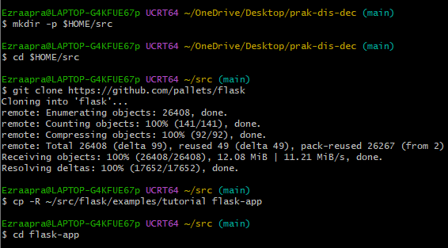

#### Pembahasan :

roses ini diawali dengan membuat direktori src sebagai tempat penyimpanan project. Selanjutnya, repository Flask diunduh menggunakan perintah git clone. Folder contoh aplikasi Flask kemudian disalin dan diberi nama flask-app sebagai direktori kerja praktikum.

### 1. Memeriksa Struktur Direktori Project

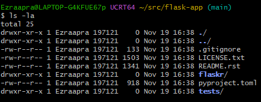

#### Pembahasan :

Proses pemeriksaan ini dilakukan untuk memvalidasi kelengkapan berkas hasil penyalinan templat, dengan tujuan memastikan seluruh komponen inti aplikasi tersedia sebelum lingkungan Python dibangun. Perintah ls -la membaca metadata sistem berkas di dalam ~/src/flask-app dan menampilkan daftar berkas beserta hak akses serta ukurannya. Keluaran terminal mengonfirmasi keberadaan direktori flaskr/, tests/, dan berkas konfigurasi pyproject.toml yang menjadi syarat instalasi paket pada tahap berikutnya.

### 2. Membuat Virtual Environment

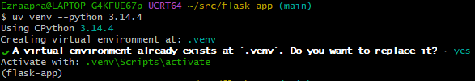

#### Pembahasan :

Perintah source .venv/Scripts/activate digunakan untuk mengaktifkan virtual environment. Setelah aktif, perintah uv pip install -e . digunakan untuk menginstal Flask beserta dependensi yang dibutuhkan project dalam mode editable.

### Mengaktifkan Virtual Environment dan Menginstal Dependensi

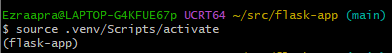

 
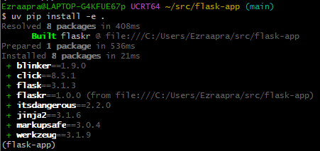

#### Pembahasan :

Perintah source .venv/Scripts/activate digunakan untuk mengaktifkan virtual environment. Setelah aktif, perintah uv pip install -e . digunakan untuk menginstal Flask beserta dependensi yang dibutuhkan project dalam mode editable.

### Inisialisasi Database dan Menjalankan Flask

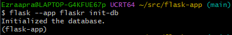

 
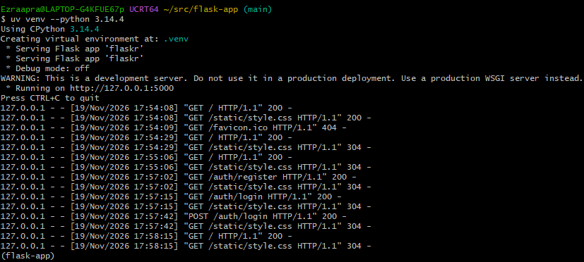

#### Pembahasan :

Proses ini dibuat untuk menyediakan skema penyimpanan data awal aplikasi dan menguji fungsionalitas layanan web secara lokal sebelum dikemas ke dalam kontainer. Tujuan proses ini adalah membentuk berkas basis data SQLite bagi aplikasi flaskr sekaligus menjalankan peladen web pengembangan untuk memverifikasi respons rute HTTP. Perintah flask --app flaskr init-db mengeksekusi skrip skema SQL di dalam modul flaskr untuk menciptakan berkas basis data pada direktori instance/ hingga menghasilkan konfirmasi Initialized the database. Selanjutnya, perintah menjalankan server pengembangan mengikat antarmuka lokal (http://127.0.0.1:5000) dan mencatat setiap permintaan klien pada log terminal, termasuk akses halaman utama (GET /), aset gaya (GET /static/style.css), pendaftaran (GET /auth/register), serta autentikasi pengguna (GET dan POST /auth/login) dengan kode status HTTP 200 dan 304. Pengujian lokal ini memastikan logika aplikasi dan koneksi basis data berjalan normal sebelum dipindahkan ke lingkungan kontainer.

### Mengakses Aplikasi Flask Melalui Browser

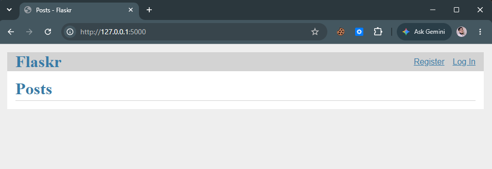

#### Pembahasan :

Aplikasi Flaskr diakses melalui browser menggunakan alamat lokal. Tampilan halaman Posts beserta menu Register dan Log In menunjukkan bahwa aplikasi berhasil dijalankan dan dapat diakses melalui browser.

### 3. Menyusunan Cetak Biru Kontainer (Dockerfile)

#### Pembahasan :

Penulisan Dockerfile ini dibuat karena mesin kontainer membutuhkan cetak biru instruksi otomatis, dengan tujuan membungkus runtime Python, kode aplikasi, dependensi, dan basis data ke dalam satu citra portabel. Instruksi FROM python:3.14, RUN mkdir /app, WORKDIR /app, dan ADD . /app/ menyiapkan lingkungan serta menyalin proyek ke dalam kontainer, lalu RUN pip install -e . dan RUN flask --app flaskr init-db memasang paket serta menginisialisasi basis data. Baris akhir EXPOSE 5000 dan CMD menetapkan port jaringan serta perintah utama untuk menjalankan peladen Flask pada seluruh antarmuka (0.0.0.0).

### Membangun Docker Image

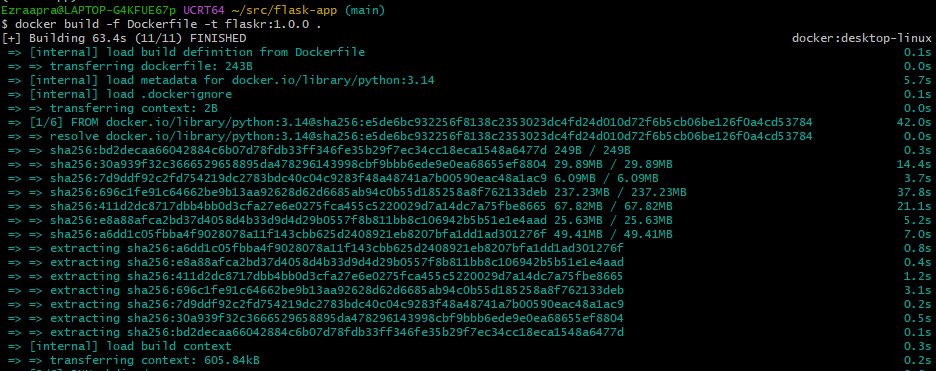

 
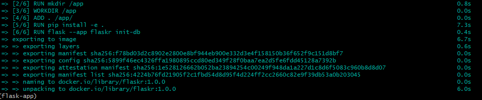

#### Pembahasan :

Pembangunan image menggunakan Docker ini dibuat untuk mengonversi seluruh instruksi pada Dockerfile menjadi artefak container image yang siap didistribusikan dan dijalankan. Tujuan utamanya adalah menghasilkan citra bernama flaskr dengan tag versi 1.0.0 (flaskr:1.0.0) di dalam registri lokal Docker Desktop. Perintah docker build -f Dockerfile -t flaskr:1.0.0 . mengirimkan konteks direktori ~/src/flask-app ke daemon Docker untuk mengeksekusi enam tahapan pembangunan mulai dari penarikan lapisan docker.io/library/python:3.14, penyalinan kode sumber, pemasangan paket via pip, hingga inisialisasi basis data. Setiap instruksi menghasilkan lapisan sistem berkas perantara yang kemudian dikemas dan diberi label akhir docker.io/library/flaskr:1.0.0. Tersimpannya citra flaskr:1.0.0 di penyimpanan lokal menjadi prasyarat langsung untuk menjalankan instans kontainer aplikasi menggunakan Docker.

### Memeriksa Docker Image

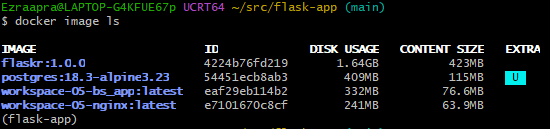

#### Pembahasan :

Perintah docker image ls digunakan untuk menampilkan daftar image yang tersedia di lingkungan Docker. Hasilnya menunjukkan image flaskr:1.0.0 telah berhasil dibuat dan tersimpan bersama image lainnya.

### Menjalankan Container Docker

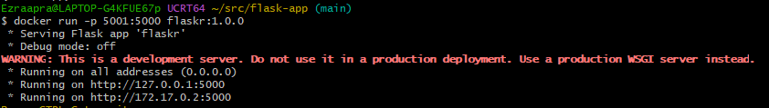

#### Pembahasan :

Perintah docker run -p 5001:5000 flaskr:1.0.0 digunakan untuk menjalankan container dari image Flaskr. Pengaturan port tersebut menghubungkan port 5001 pada komputer dengan port 5000 di dalam container agar aplikasi dapat diakses dari luar container.

### Menguji Aplikasi pada Container Docker

#### Pembahasan:

Aplikasi yang berjalan di dalam container diuji melalui browser menggunakan alamat lokal. Tampilan halaman Flaskr menunjukkan bahwa aplikasi berhasil dijalankan dan dapat diakses setelah proses deployment menggunakan Docker.

### Membangun Image Menggunakan Podman

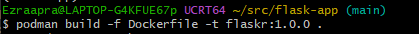

 
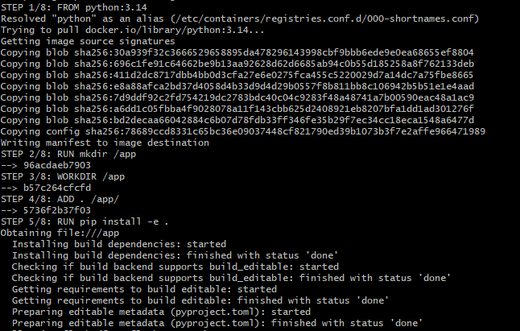

 
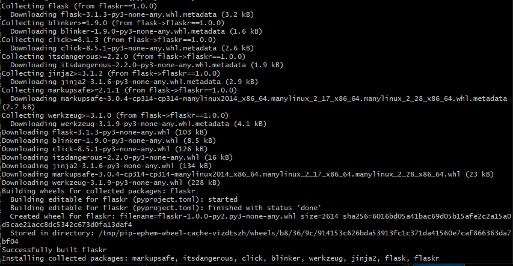

 
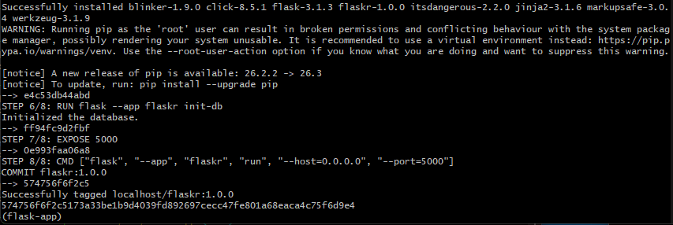

#### Pembahasan :

Perintah podman build -f Dockerfile -t flaskr:1.0.0 . digunakan untuk membangun image aplikasi dengan Podman berdasarkan Dockerfile yang telah dibuat. Proses pembangunan mencakup penggunaan Python, pembuatan direktori kerja, instalasi dependensi, dan konfigurasi aplikasi hingga image berhasil dibuat.

### Memeriksa Image Podman

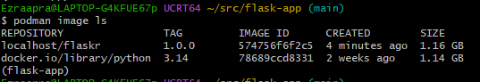

#### Pembahasan :

Perintah podman image ls digunakan untuk menampilkan daftar image yang tersedia pada Podman. Hasilnya menunjukkan image localhost/flaskr dengan tag 1.0.0 telah berhasil dibuat dan tersimpan di lingkungan Podman.

### Menjalankan dan Menguji Container Podman

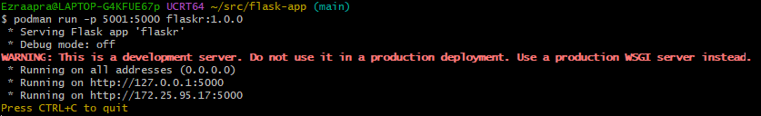

### Hasil Aplikasi 

#### Pembahasan:

Perintah podman run -p 5001:5000 flaskr:1.0.0 digunakan untuk menjalankan container menggunakan image Flaskr yang telah dibangun. Selanjutnya, aplikasi diakses melalui browser untuk memastikan container berjalan dengan baik dan halaman Flaskr dapat ditampilkan.

## TUGAS

**1. Carilah berbagai contoh vendor/komunitas SaaS, PaaS, dan IaaS masing-masing 1 saja.**

__Jawab :__

| Kategori | Vendor | Produk/Layanan |
|---|---|---|
| SaaS | Google | Google Workspace |
| PaaS | Google Cloud | Google App Engine |
| IaaS | Amazon Web Services (AWS) | Amazon EC2 |

 

**2. Uraikan apa yang menjadi service dari berbagai vendor untuk berbagai kategori XaaS tersebut.**

**a. SaaS (Software as a Service) – Google Workspace**

Google Workspace merupakan layanan perangkat lunak berbasis cloud yang dapat digunakan secara langsung melalui internet tanpa perlu melakukan instalasi aplikasi secara manual pada komputer. Layanan yang tersedia meliputi Gmail untuk email, Google Drive untuk penyimpanan file, Google Docs untuk pengolahan dokumen, serta Google Meet untuk komunikasi melalui video.

**b. PaaS (Platform as a Service) – Google App Engine**

Google App Engine merupakan layanan platform cloud yang menyediakan lingkungan untuk mengembangkan, menjalankan, dan mengelola aplikasi. Pengembang dapat mengunggah kode program tanpa harus mengatur server secara langsung karena penyedia layanan menangani infrastruktur, penyediaan server, dan penyesuaian kapasitas aplikasi sesuai kebutuhan.

**c.IaaS (Infrastructure as a Service) – Amazon EC2**

Amazon EC2 merupakan layanan cloud yang menyediakan server virtual dengan sumber daya komputasi sesuai kebutuhan pengguna. Layanan ini memungkinkan pengguna mengatur sistem operasi, kapasitas komputasi, penyimpanan, dan jaringan untuk menjalankan aplikasi tanpa harus memiliki server fisik sendiri.

**3. Jelaskan secara umum arsitektur dari XaaS tersebut dalam bentuk visualisasi gambar.**

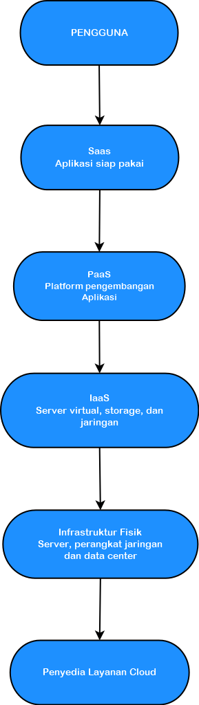

 

**Penjelasan :**

Arsitektur tersebut menunjukkan bahwa infrastruktur fisik menjadi dasar penyediaan layanan cloud. Di atasnya terdapat IaaS yang menyediakan sumber daya komputasi, PaaS yang menyediakan platform pengembangan aplikasi, dan SaaS yang menyediakan aplikasi siap digunakan oleh pengguna. Ketiga model tersebut memiliki tingkat pengelolaan yang berbeda sesuai kebutuhan penggunanya.

### Kesimpulan 

Berdasarkan praktikum Modul 7, dapat disimpulkan bahwa Cloud Computing merupakan teknologi yang memungkinkan pengguna memanfaatkan sumber daya komputasi melalui internet dalam bentuk layanan. Melalui model SaaS, PaaS, dan IaaS, pengguna dapat memperoleh layanan perangkat lunak, platform pengembangan, hingga infrastruktur virtual sesuai kebutuhan.

Praktikum ini juga memberikan pemahaman mengenai penerapan Containerized Application dengan membuat aplikasi Flask menjadi container menggunakan Docker dan Podman. Proses tersebut meliputi persiapan lingkungan Python, instalasi dependensi, inisialisasi database, pembuatan Dockerfile, pembangunan image, serta menjalankan container melalui pemetaan port. Dengan demikian, praktikum ini memberikan pemahaman dasar tentang penerapan teknologi cloud dan container dalam menjalankan aplikasi secara lebih praktis dan terstruktur.