# Praktik 8 - Arsitektur Microservices untuk Sistem Terdistribusi

Judul Modul : Arsitektur Microservices untuk Sistem Terdistribusi 
Mata Kuliah : **Praktikum Sistem Terdistribusi dan Terdesentralisasi**

| Field | Keterangan |
| :--- | :--- |
| **Nama** | Ezra Adyatma Pranantio |
| **NIM** | 255410002 |

---

## 📌 Tujuan Praktikum

1. Memahami konsep dan penerapan arsitektur _Microservices_ dalam membangun sistem terdistribusi.

2. Memahami cara kerja RESTful API sebagai penghubung komunikasi antara _frontend_ dan _backend_.

3. Mempelajari penggunaan _FastAPI_ dan SQLModel untuk membangun layanan backend serta mengelola data dalam database.

4. Mengimplementasikan database SQLite untuk menyimpan dan mengelola data menggunakan Python.

5. Memahami penerapan _Dependency Injection dan Session_ pada _FastAPI_ untuk mengelola koneksi serta akses data ke database secara terstruktur.

## 📖 Dasar Teori

### 1. Arsitektur Microservices

Dalam pengembangan sistem terdistribusi, arsitektur <em>Microservices</em> memungkinkan aplikasi dibagi menjadi beberapa layanan (services) yang dapat berjalan dan dikelola secara terpisah. Frontend berperan sebagai antarmuka pengguna (UI/UX), sedangkan backend menyediakan layanan yang dibutuhkan oleh aplikasi. Komunikasi antarlayanan dapat dilakukan melalui teknologi seperti REST API, GraphQL, dan gRPC sehingga setiap layanan dapat saling berinteraksi.

### 2. RESTful API

Komunikasi antara frontend dan backend dapat dilakukan menggunakan RESTful API melalui protokol HTTP. Mekanisme ini memungkinkan aplikasi mengirim permintaan dan menerima respons untuk mengakses data atau layanan tertentu. Dalam praktikum ini, RESTful API digunakan untuk menyediakan <em>endpoint</em> yang dapat mengambil dan menampilkan data dari database.

### 3. FastAPI*

Untuk membangun layanan <em>backend</em> berbasis Python, praktikum ini memanfaatkan <em>FastAPI</em> sebagai <em>framework</em> pengembangan web API. Framework ini mendukung pembuatan <em>endpoint</em> untuk menangani permintaan pengguna serta menghasilkan respons dalam format JSON. <em>FastAPI</em> juga digunakan untuk menghubungkan proses pengaksesan data dengan layanan API yang dijalankan.

### 4. SQLModel dan ORM

Pengelolaan struktur dan interaksi dengan database dapat dilakukan menggunakan SQLModel melalui pendekatan <em>Object Relational Mapping</em> (ORM). Pustaka ini memungkinkan tabel database direpresentasikan dalam bentuk class Python sehingga pengelolaan data dapat dilakukan menggunakan objek. Dalam praktikum ini, SQLModel digunakan untuk mendefinisikan struktur tabel, membuat koneksi database, serta menjalankan perintah pengambilan data.

### 5. Database SQLite

Penyimpanan data pada praktikum ini menggunakan SQLite yang menyimpan informasi secara langsung dalam sebuah file tanpa memerlukan server database terpisah. SQLite mendukung perintah SQL untuk membuat tabel, memasukkan data, dan mengambil informasi yang tersimpan. Database ini dihubungkan dengan aplikasi Python melalui SQLModel agar data dapat diakses dan dikelola oleh <em>backend</em>.

### 6. Dependency Injection dan Session

Dalam pengelolaan koneksi database pada <em>FastAPI, Dependency Injection</em> digunakan untuk menyediakan kebutuhan tertentu kepada fungsi yang memerlukannya. Penerapannya terlihat pada Depends(get_session) yang memberikan objek Session kepada <em>endpoint API</em>. Objek Session berfungsi sebagai penghubung antara aplikasi dan database SQLite untuk menjalankan operasi pengambilan data. Fungsi get_session() menggunakan yield untuk menyediakan session selama proses berlangsung, sedangkan context manager membantu mengelola siklus penggunaannya secara terstruktur.

 

# 📝Pembahasan Praktikum

## 1. Prasyarat

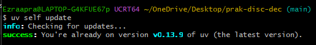

#### Pembahasan : 

Sebelum memulai praktikum, dilakukan pembaruan perangkat uv menggunakan perintah uv self update. Perintah ini memeriksa versi terbaru dan memastikan perangkat uv sudah menggunakan versi terkini sehingga proses instalasi Python dan pengelolaan lingkungan praktikum dapat berjalan dengan baik. Pada hasil yang ditampilkan, uv diketahui sudah menggunakan versi 0.13.9 sehingga tidak diperlukan proses pengunduhan maupun pembaruan lebih lanjut. Dengan demikian, perangkat uv siap digunakan untuk melanjutkan tahapan persiapan proyek.

### Memeriksa Daftar Versi Python

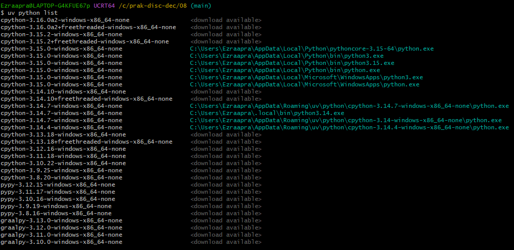

#### Pembahasan : 

Perintah uv python list digunakan untuk menampilkan daftar versi Python yang tersedia maupun yang telah terpasang pada sistem. Melalui perintah ini, pengguna dapat mengetahui versi Python yang dapat digunakan sebelum menentukan versi untuk proyek praktikum. Hasil pemeriksaan menunjukkan beberapa versi Python, termasuk versi 3.14.4 yang telah tersedia pada komputer. Informasi tersebut menjadi dasar untuk menentukan interpreter Python yang akan digunakan dalam lingkungan pengembangan.

### Menentukan Versi Python pada Proyek

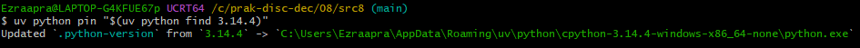

#### Pembahasan : 

Perintah uv python pin "$(uv python find 3.14)" digunakan untuk menentukan Python versi 3.14 sebagai interpreter yang digunakan dalam proyek. Proses ini menghasilkan konfigurasi versi Python pada proyek sehingga lingkungan pengembangan menggunakan versi yang telah ditentukan. Berdasarkan hasil terminal, versi Python 3.14.4 berhasil ditetapkan sebagai interpreter proyek. Pengaturan ini membantu menjaga konsistensi versi Python selama proses pengembangan dan pelaksanaan praktikum.

### Membuat Virtual Environment

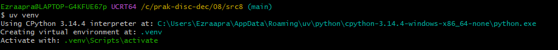

#### Pembahasan : 

Pembuatan lingkungan virtual dilakukan menggunakan perintah uv venv untuk menyediakan ruang kerja Python yang terpisah dari instalasi utama sistem. Lingkungan ini berfungsi agar paket dan dependensi yang digunakan dalam praktikum dapat dikelola secara khusus tanpa memengaruhi proyek Python lainnya. Hasil terminal menunjukkan bahwa virtual environment berhasil dibuat pada direktori .venv. Proses ini juga menampilkan petunjuk perintah aktivasi yang dapat digunakan untuk mulai bekerja di dalam lingkungan tersebut.

### Mengaktifkan Virtual Environment

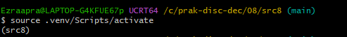

#### Pembahasan : 

Perintah source .venv/Scripts/activate digunakan untuk mengaktifkan lingkungan virtual yang telah dibuat sebelumnya pada sistem Windows melalui Git Bash. Setelah berhasil diaktifkan, tanda (src8) muncul pada terminal sebagai penanda bahwa perintah berikutnya dijalankan dalam lingkungan virtual tersebut. Aktivasi ini memungkinkan proses instalasi pustaka dilakukan pada lingkungan proyek yang telah disiapkan. Dengan demikian, dependensi praktikum dapat dikelola secara terpisah dari lingkungan Python utama.

### Menginstal FastAPI dan SQLModel

#### Pembahasan : 

Instalasi pustaka dilakukan menggunakan perintah uv pip install "fastapi[standard]" sqlmodel. Perintah tersebut memasang FastAPI beserta dependensi standarnya dan SQLModel yang diperlukan untuk membangun layanan RESTful API serta mengelola interaksi antara aplikasi Python dengan database. FastAPI digunakan untuk menangani permintaan API, sedangkan SQLModel membantu mendefinisikan model dan mengelola data database. Kedua pustaka tersebut menjadi komponen utama dalam pembuatan aplikasi backend pada praktikum ini.

### Memeriksa Hasil Instalasi Paket

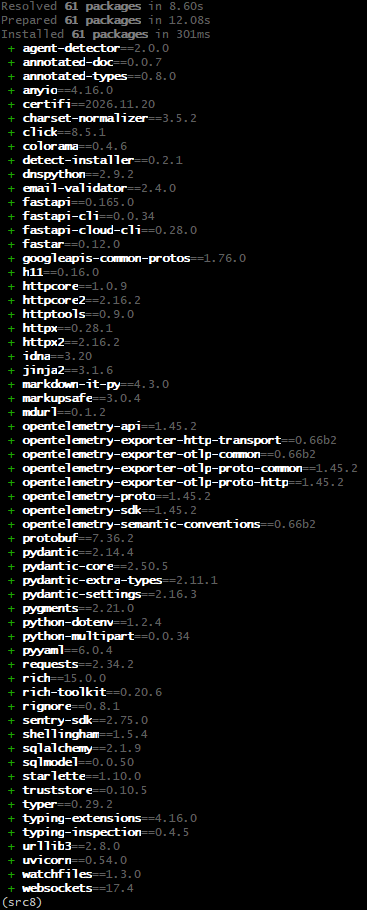

#### Pembahasan : 

Setelah proses instalasi dijalankan, terminal menampilkan daftar paket yang berhasil dipasang beserta versi masing-masing dependensi. Hasil tersebut menunjukkan bahwa FastAPI, SQLModel, dan pustaka pendukungnya telah berhasil diinstal ke dalam virtual environment sehingga siap digunakan untuk pengembangan aplikasi. Informasi jumlah paket yang berhasil dipasang juga ditampilkan sebagai hasil dari proses instalasi. Dengan tersedianya seluruh dependensi tersebut, tahap persiapan perangkat lunak dapat dilanjutkan ke proses penggunaan database dan pembuatan API.

### Memeriksa Versi SQLite

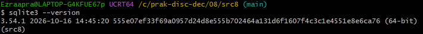

#### Pembahasan : 

Pemeriksaan SQLite dilakukan menggunakan perintah sqlite3 --version untuk mengetahui versi SQLite yang telah terpasang pada sistem. Hasil perintah menampilkan informasi versi dan waktu kompilasi SQLite sebagai bukti bahwa perangkat database tersedia dan dapat digunakan. Pada terminal terlihat bahwa SQLite versi 3.54.1 berhasil dikenali oleh sistem. Pemeriksaan ini dilakukan untuk memastikan perangkat database siap digunakan dalam proses pembuatan dan pengelolaan tabel.

### Mengakses Halaman Unduhan SQLite

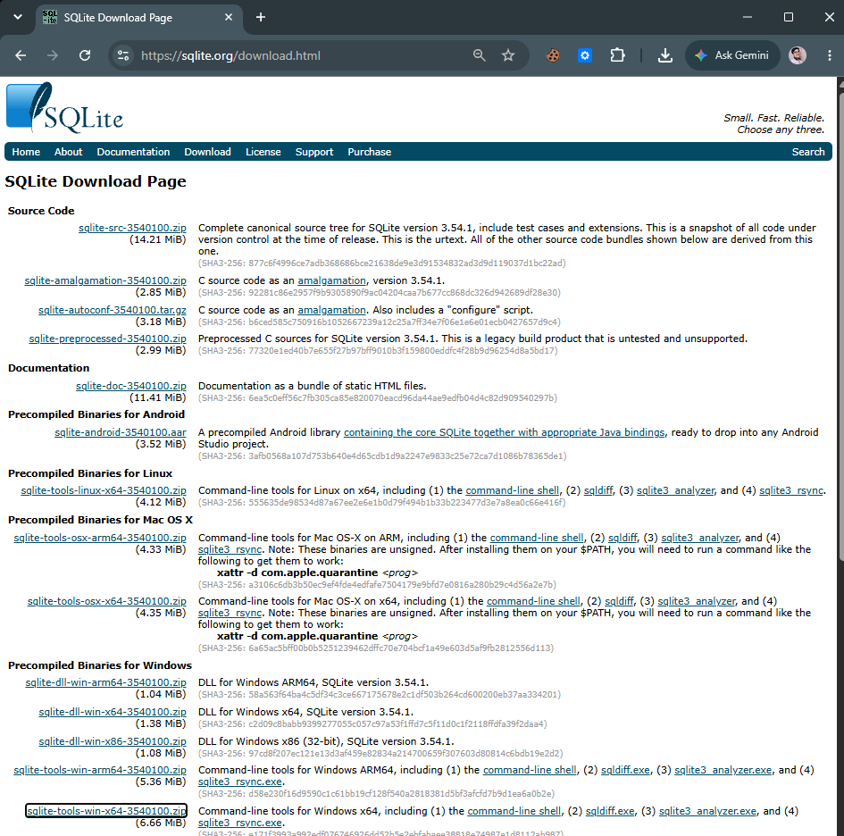

#### Pembahasan : 

Halaman resmi SQLite diakses melalui browser untuk memperoleh perangkat SQLite sesuai dengan sistem operasi yang digunakan. Pada bagian Precompiled Binaries for Windows, tersedia berkas yang diperlukan untuk menjalankan SQLite melalui command line pada Windows. Halaman tersebut juga menyediakan beberapa pilihan paket berdasarkan arsitektur sistem operasi, seperti ARM64 dan x64. Pemilihan berkas yang sesuai diperlukan agar perangkat SQLite dapat digunakan dengan baik pada komputer yang digunakan untuk praktikum.

### Membuat Database dan Mengisi Data SDM

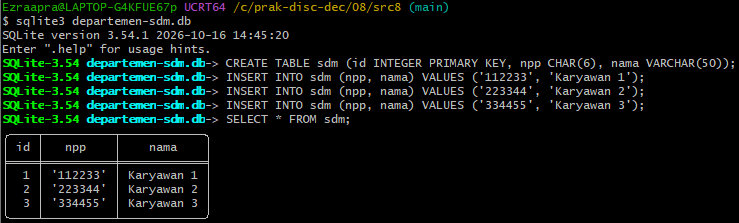

#### Pembahasan : 

Database departemen-sdm.db dibuka menggunakan perintah sqlite3 departemen-sdm.db, kemudian dibuat tabel sdm dengan kolom id, npp, dan nama. Selanjutnya, tiga data karyawan dimasukkan menggunakan perintah INSERT INTO, kemudian perintah SELECT * FROM sdm digunakan untuk menampilkan seluruh data yang telah disimpan. Kolom id ditetapkan sebagai primary key untuk memberikan identitas unik pada setiap data karyawan. Hasil penampilan tabel menunjukkan bahwa ketiga data berhasil dimasukkan dan tersimpan di dalam database SQLite.

### Menampilkan Data dari Tabel SDM

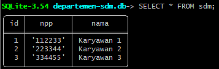

#### Pembahasan : 

Perintah SELECT * FROM sdm; digunakan untuk mengambil seluruh data yang tersimpan pada tabel SDM. Hasilnya menampilkan tiga data karyawan beserta nomor identitas dan nama masing-masing, sehingga dapat dipastikan bahwa proses penyimpanan data sebelumnya berhasil dilakukan. Perintah tersebut mengambil seluruh kolom tanpa harus menyebutkan nama kolom satu per satu. Hasil ini menjadi dasar untuk menghubungkan data database dengan layanan API yang akan dibuat menggunakan FastAPI.

## 2. Source Code

### Membuat File service.py

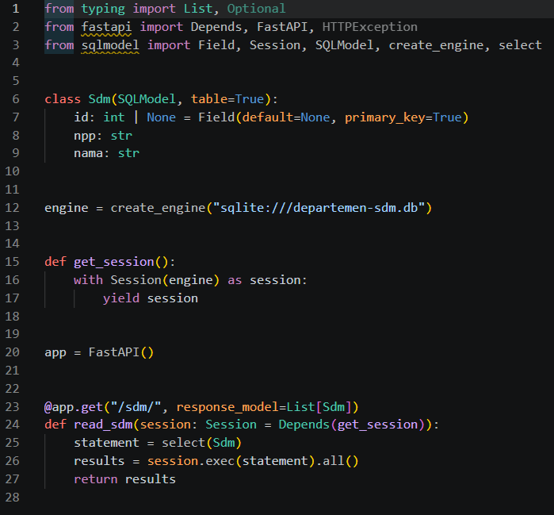

#### Pembahasan : 

File service.py digunakan untuk menyusun layanan RESTful API yang menghubungkan FastAPI dengan database SQLite. Di dalamnya terdapat model Sdm, konfigurasi koneksi database, fungsi get_session() untuk menyediakan session melalui Dependency Injection, serta endpoint GET /sdm/ yang menggunakan select(Sdm) untuk mengambil seluruh data dan mengembalikannya dalam bentuk JSON. Penggunaan Depends(get_session) memungkinkan endpoint memperoleh session database tanpa harus membuat koneksi secara langsung di dalam fungsi endpoint. Sementara itu, session.exec(statement).all() menjalankan perintah pengambilan data dan menghasilkan seluruh baris yang tersedia pada tabel SDM.

## 3. Menjalankan Source Code

### Menjalankan Server FastAPI

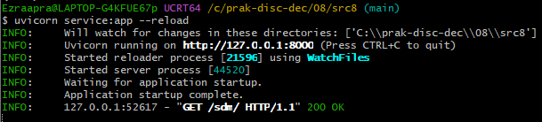

#### Pembahasan : 

Server aplikasi dijalankan menggunakan perintah uvicorn service:app --reload untuk menjalankan objek aplikasi FastAPI yang terdapat dalam file service.py. Opsi --reload memungkinkan server memuat ulang aplikasi secara otomatis ketika terdapat perubahan source code, sedangkan alamat 127.0.0.1:8000 menunjukkan bahwa server berjalan secara lokal. Terminal menampilkan informasi bahwa proses server telah berjalan dan aplikasi berhasil menyelesaikan tahap startup. Dengan kondisi tersebut, layanan API sudah dapat menerima permintaan dari browser maupun perangkat command line.

### Mengakses Endpoint SDM melalui Browser

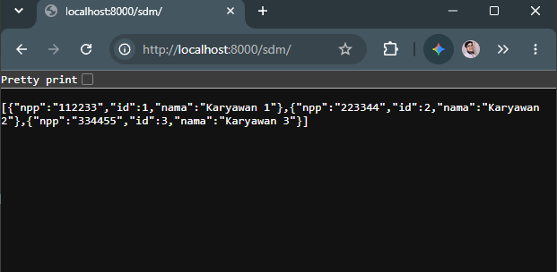

#### Pembahasan : 

engujian endpoint dilakukan dengan mengakses alamat http://localhost:8000/sdm/ melalui browser. FastAPI memproses permintaan tersebut dan menampilkan seluruh data karyawan dari database dalam format JSON, yang menunjukkan bahwa endpoint berhasil mengambil dan mengirimkan data kepada pengguna. Data yang ditampilkan mencakup NPP, nama karyawan, dan ID dari masing-masing baris. Hasil tersebut membuktikan bahwa komunikasi antara endpoint API dengan database SQLite telah berjalan sesuai dengan fungsi yang dibuat.

### Menguji Endpoint SDM Menggunakan curl

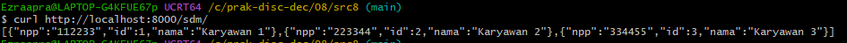

#### Pembahasan : 

Perintah curl http://localhost:8000/sdm/ digunakan untuk mengirim permintaan HTTP GET secara langsung melalui terminal. Hasilnya menampilkan data karyawan dalam format JSON yang sama dengan hasil pengujian melalui browser, sehingga endpoint dapat diakses melalui perangkat command line. Penggunaan curl mempermudah pengujian layanan API tanpa harus membuka browser. Hasil respons tersebut menunjukkan bahwa server berhasil memproses permintaan dan mengembalikan data dari database.

## 4. Tugas

### 1. Buat satu tabel baru menggunakan SQLite, tabel berbeda dari yang ada pada contoh. Tabel tersebut mempunyai 1 primary key dan setidaknya berisi data dengan tipe INT, CHAR, VARCHAR, BOOLEAN, dan FLOAT.

### Membuka Database Inventaris
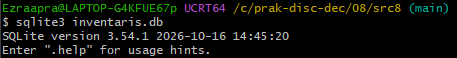

#### Pembahasan :

Database baru dibuat dan dibuka menggunakan perintah sqlite3 inventaris.db sebagai tempat penyimpanan data produk. Database ini digunakan untuk memenuhi tugas praktikum dengan membuat tabel baru yang memiliki satu primary key serta beberapa kolom dengan tipe data yang berbeda. Setelah perintah dijalankan, terminal menampilkan informasi versi SQLite dan prompt sqlite> sebagai tanda bahwa database berhasil dibuka. Selanjutnya, perintah SQL dapat dimasukkan untuk membuat struktur tabel yang dibutuhkan.

### Membuat Tabel Produk pada SQLite
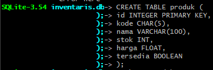

#### Pembahasan :

Perintah CREATE TABLE produk digunakan untuk membuat tabel produk dengan enam kolom, yaitu id, kode, nama, stok, harga, dan tersedia. Setiap kolom menggunakan tipe data yang sesuai, meliputi INTEGER, CHAR, VARCHAR, FLOAT, dan BOOLEAN, sedangkan kolom id ditetapkan sebagai primary key. Kolom kode digunakan untuk menyimpan kode produk, sedangkan nama digunakan untuk menyimpan nama produk. Sementara itu, kolom stok, harga, dan tersedia digunakan untuk menyimpan jumlah persediaan, nilai harga, serta status ketersediaan produk.

### Memeriksa Struktur Tabel Produk
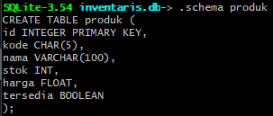

#### Pembahasan :

Perintah .schema produk digunakan untuk menampilkan struktur SQL dari tabel produk yang telah dibuat sebelumnya. Hasilnya memperlihatkan definisi setiap kolom beserta tipe datanya dan penetapan primary key pada kolom id, sehingga struktur tabel dapat diperiksa kembali. Pemeriksaan ini membantu memastikan bahwa tabel telah dibuat sesuai dengan perintah tugas praktikum. Dengan demikian, struktur database siap digunakan untuk proses pengisian data produk.

### Memeriksa Detail Struktur Kolom Tabel
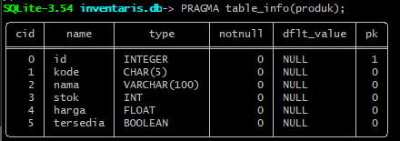

#### Pembahasan :

Perintah PRAGMA table_info(produk); digunakan untuk menampilkan informasi detail dari setiap kolom pada tabel produk. Hasilnya memperlihatkan nama kolom, tipe data, pengaturan null, nilai default, dan status primary key sehingga kesesuaian struktur tabel dapat diverifikasi. Pada hasil tersebut, kolom id terlihat memiliki nilai pk sebesar 1 yang menunjukkan bahwa kolom tersebut ditetapkan sebagai primary key. Informasi ini memastikan bahwa struktur tabel telah memiliki identitas utama dan tipe data yang dibutuhkan untuk menyimpan informasi produk.

### 2. Isikan 5 data menggunakan script Python

### Membuat Script Python untuk Mengisi Data Produk
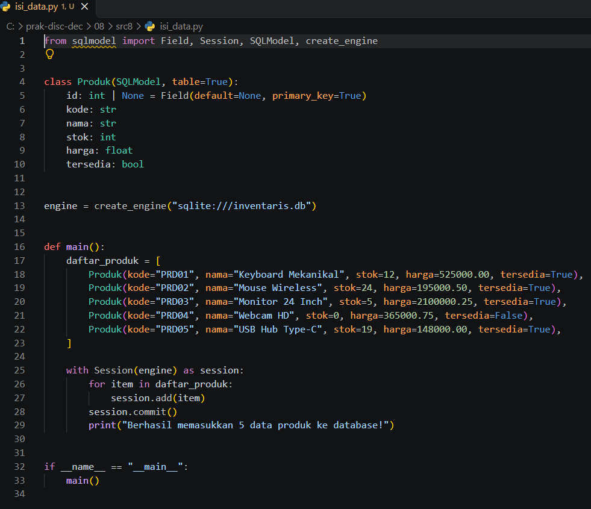

#### Pembahasan :

File isi_data.py dibuat untuk memasukkan lima data produk ke dalam database inventaris.db menggunakan SQLModel. Data produk didefinisikan melalui objek Produk, kemudian dimasukkan ke database menggunakan session.add() dan disimpan secara permanen melalui session.commit(). Lima data yang dimasukkan terdiri dari Keyboard Mekanikal, Mouse Wireless, Monitor 24 Inch, Webcam HD, dan USB Hub Type-C. Penggunaan perulangan for membantu memasukkan seluruh objek produk ke dalam session tanpa harus menuliskan perintah penyimpanan secara berulang.

### Menampilkan Data Produk dari Database
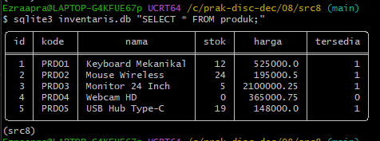

#### Pembahasan :

Perintah SELECT * FROM produk; digunakan untuk mengambil seluruh data produk yang telah dimasukkan melalui script Python. Hasilnya menampilkan lima produk beserta kode, nama, stok, harga, dan status ketersediaannya, sehingga proses pengisian data ke database berhasil dilakukan. Setiap produk memiliki ID yang berbeda sebagai identitas masing-masing data di dalam tabel. Hasil tersebut juga memperlihatkan bahwa nilai numerik dan status ketersediaan telah tersimpan sesuai dengan data yang dimasukkan melalui program Python.

### 3. Buat RESTful API endpoint untuk menampilkan semua data yang telah diisikan.

### Membuat RESTful API untuk Data Produk

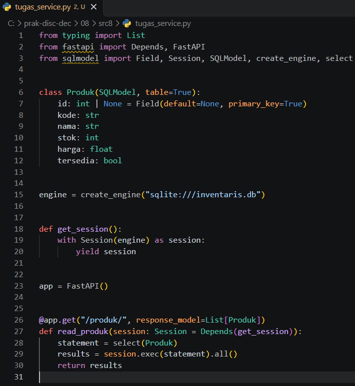

#### Pembahasan :

File tugas_service.py dibuat untuk menyediakan layanan RESTful API yang mengakses database inventaris.db. Program mendefinisikan model Produk, mengatur koneksi database dan session menggunakan Dependency Injection, serta membuat endpoint GET /produk/ dengan perintah select(Produk) untuk mengambil seluruh data produk dan mengembalikannya dalam format JSON. Fungsi get_session() menyediakan session database melalui Depends(get_session) agar endpoint dapat menjalankan operasi pengambilan data. Seluruh hasil query kemudian dikembalikan melalui return results sehingga dapat diakses oleh pengguna melalui endpoint yang telah ditentukan.

### Menjalankan Server API Data Produk
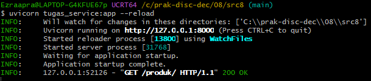

#### Pembahasan :

Server untuk layanan data produk dijalankan menggunakan perintah uvicorn tugas_service:app --reload. Setelah aplikasi berhasil dijalankan, server menampilkan informasi alamat lokal dan status bahwa aplikasi telah selesai melakukan proses startup, sehingga endpoint produk siap diuji. Server berjalan pada alamat 127.0.0.1:8000 dan menunggu permintaan dari pengguna. Dengan demikian, aplikasi backend telah siap digunakan untuk menampilkan data produk melalui RESTful API.

### Mengakses Endpoint Produk melalui Browser
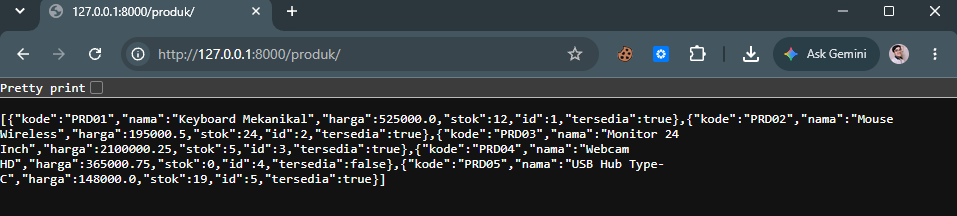

#### Pembahasan :

Endpoint produk diuji melalui browser dengan mengakses alamat http://127.0.0.1:8000/produk/. Server memproses permintaan dan menampilkan lima data produk dalam format JSON yang mencakup kode, nama, harga, stok, ID, dan status ketersediaan produk. Setiap data ditampilkan dalam satu objek JSON sehingga informasi dari seluruh produk dapat diterima melalui satu permintaan API. Hasil tersebut menunjukkan bahwa endpoint berhasil mengambil data dari database inventaris dan menyajikannya kepada pengguna.

### 4. Tampilkan hasil RESTful API endpoint tersebut menggunakan curl.

### Mengakses Endpoint Produk melalui Browser
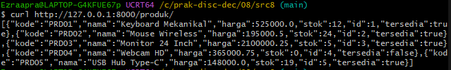

#### Pembahasan :

Pengujian terakhir dilakukan menggunakan perintah curl http://127.0.0.1:8000/produk/ untuk mengirim permintaan GET melalui terminal. Hasilnya menampilkan seluruh lima data produk dalam format JSON, yang membuktikan bahwa RESTful API berhasil mengambil dan menyajikan data dari database SQLite melalui command line. Respons yang diterima berisi informasi produk yang sama dengan hasil pengujian melalui browser. Dengan demikian, pembuatan database, pengisian data menggunakan Python, serta penyediaan endpoint API telah berhasil diterapkan sesuai dengan tugas praktikum.

---

### Kesimpulan

Berdasarkan penerapan materi pada Modul 8, dapat disimpulkan bahwa arsitektur Microservices mendukung pengembangan sistem terdistribusi melalui pembagian layanan yang dapat dikelola secara terpisah dan saling berkomunikasi. RESTful API berperan sebagai penghubung antara frontend dan backend melalui protokol HTTP, sedangkan FastAPI menyediakan framework untuk membangun layanan API yang efisien. SQLModel dengan pendekatan ORM mempermudah pengelolaan struktur dan interaksi database menggunakan objek Python, sementara SQLite berfungsi sebagai media penyimpanan data yang sederhana dan terintegrasi. Selain itu, penerapan Dependency Injection dan Session membantu mengelola kebutuhan koneksi database secara terstruktur sehingga akses dan pengambilan data dapat dilakukan melalui endpoint API. Dengan memahami konsep-konsep tersebut, pengembangan aplikasi berbasis sistem terdistribusi dapat dilakukan secara lebih terstruktur, modular, dan mudah dikelola.